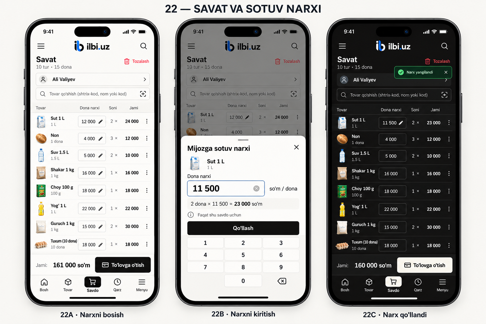
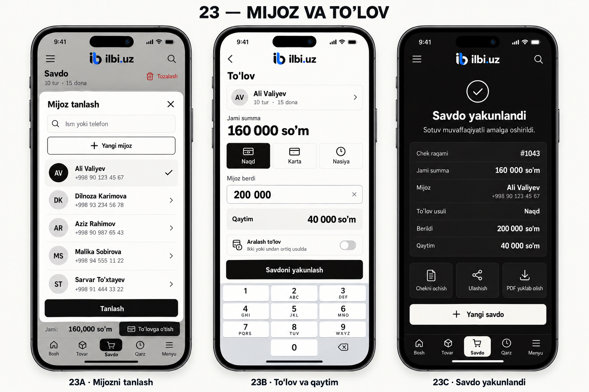
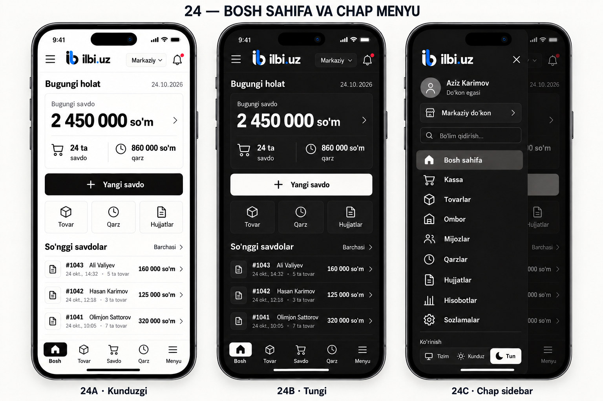
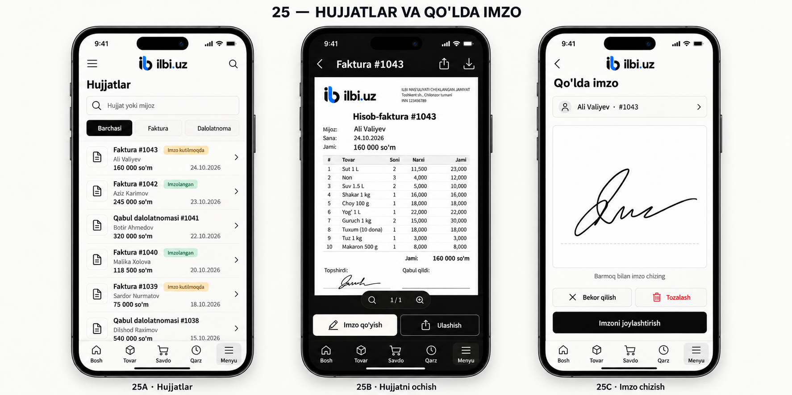
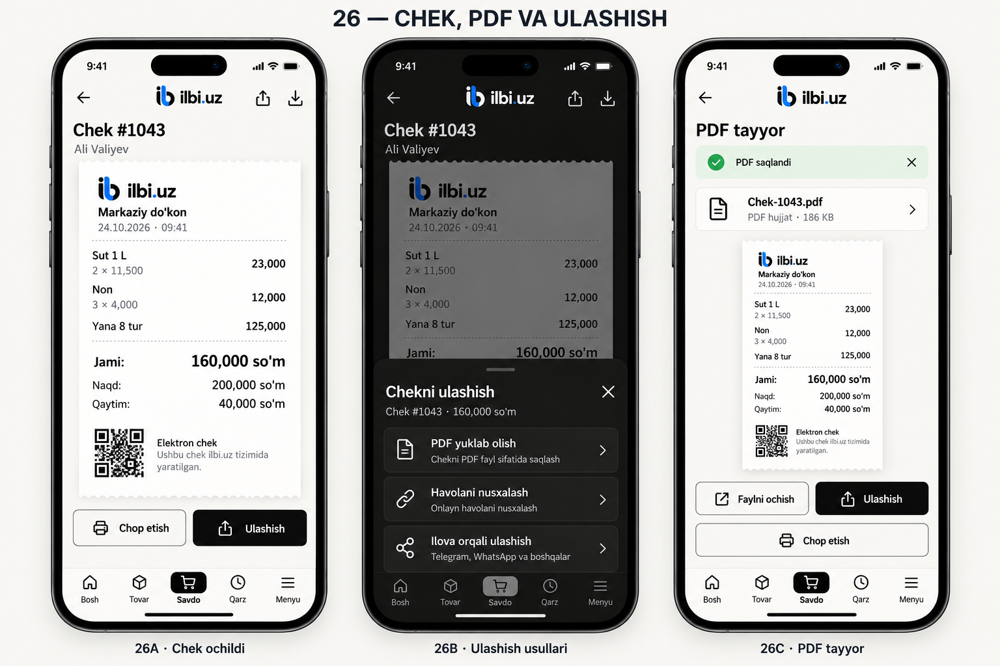
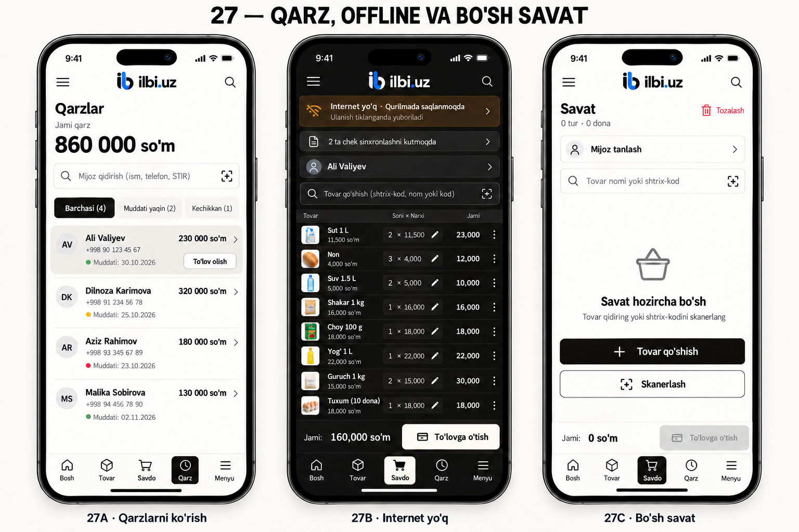

# ILBI Mobile App — Master Implementation Prompt

**Language of this specification:** English.

**Default language of the app interface:** Uzbek, Latin script.

**Target platforms:** Android and iPhone, using React Native and TypeScript.

**Specification date:** 24 October 2026.

**Purpose:** Give this document, its accompanying images, and the existing repository to an implementation AI.

**Directory entry point:** Read [ILBI Mobile — Start Here](../README.md) first for the v1–v4 folder map, current design direction, reading order, and kickoff instruction. This document remains the detailed implementation contract.

> Your assignment is to build and verify a working mobile application, following the owner's design decisions below. Work in small, dependency-ordered increments. After each increment, run it, interact with it, inspect the result, fix defects, and rerun the relevant checks. Advance only after the current acceptance gate passes. A screenshot, successful compilation, or mocked API response alone does not prove that a feature works.

## Contents

1. [Read first: execution contract](#1-read-first-execution-contract)
2. [Project context and sources of truth](#2-project-context-and-sources-of-truth)
3. [Visual references: all 18 screen states](#3-visual-references-all-18-screen-states)
4. [Design system and interaction rules](#4-design-system-and-interaction-rules)
5. [Navigation and application structure](#5-navigation-and-application-structure)
6. [Feature specifications](#6-feature-specifications)
7. [Data, API, money, and account isolation](#7-data-api-money-and-account-isolation)
8. [Offline behavior and synchronization](#8-offline-behavior-and-synchronization)
9. [Performance and accessibility](#9-performance-and-accessibility)
10. [Mandatory phased implementation plan](#10-mandatory-phased-implementation-plan)
11. [Test scenarios and reference data](#11-test-scenarios-and-reference-data)
12. [Evidence, defect handling, and progress files](#12-evidence-defect-handling-and-progress-files)
13. [Final acceptance and handover](#13-final-acceptance-and-handover)
14. [Official technical references](#14-official-technical-references)
15. [Start here](#15-start-here)

---

## 1. Read first: execution contract

### 1.1 Your role

Act as the mobile engineer, UI implementer, integration engineer, and tester for the existing ILBI Sales Platform. Deliver actual code and evidence that it works. Do not stop after writing a plan, generating screenshots, or creating a collection of disconnected screens.

The owner's priorities, in order, are:

1. Correct sales, prices, quantities, payments, documents, and stored data.
2. Fast, understandable everyday operation.
3. The approved mobile design, including compact layouts and the real logo.
4. Reliable behavior on both Android and iOS.
5. Restrained, smooth animation that helps the interaction.

The owner does not want repeated requests to approve ordinary implementation steps. Make reasonable decisions within this specification, record them, and continue after a gate passes. Ask a concise question only when essential information cannot be discovered or a genuine product decision is required. Continue independent, unblocked work while waiting.

### 1.2 The mandatory work loop

For every independently testable increment, follow this order:

~~~text
READ the relevant specification and existing code
    ↓
DEFINE the behavior and acceptance checks
    ↓
IMPLEMENT one small vertical slice
    ↓
RUN the application
    ↓
EXERCISE the actual interaction
    ↓
INSPECT screen output, logs, network behavior, and persisted state
    ↓
RECORD each defect
    ↓
FIX the cause and run the failed check again
    ↓
RUN the relevant regression checks
    ↓
SAVE evidence and update the progress record
    ↓
ADVANCE only when this gate passes
~~~

Do not write all screens first and postpone integration and testing until the end.

### 1.3 Non-negotiable operating rules

- Inspect repository instructions, the current Git state, existing mobile code, and the relevant backend contracts before editing.
- Preserve unrelated user changes. Do not reset, overwrite, or clean the workspace indiscriminately.
- Reuse existing business rules; do not invent an independent mobile accounting system.
- Build native React Native screens. Do not wrap the desktop website in a full-app WebView.
- A focused PDF viewer or isolated document-rendering component may use a suitable platform component; that is not permission to make the entire app a website.
- Never use static mockup images as functioning app screens.
- Never hard-code the sample balances, customer names, checkout success, or synchronization status into production logic.
- Never make an enabled action display a fake success toast without performing its stated operation.
- Handle loading, empty, error, validation, permission, offline, cancellation, and success states.
- Keep fixtures, mocks, screenshots, and test accounts isolated from production data.
- Do not change authentication, authorization, tax, fiscal, or synchronization rules merely to make a test pass.
- Do not suppress failures with broad exception handlers, disabled assertions, blanket lint exemptions, or fake API responses.
- Do not claim an Android or iOS test passed unless that platform was actually exercised.
- No recurring ZIP archives. Deliver source files, normal documentation, images, and the required native build artifacts.
- Do not deploy to production, publish to app stores, send real customer messages, or incur paid build charges without authorization for that action.
- After a gate passes, proceed autonomously to the next gate. A passing gate does not require another permission question.

### 1.4 When a prerequisite is genuinely unavailable

Use these statuses consistently:

| Status | Meaning |
| --- | --- |
| NOT STARTED | Work has not begun. |
| IN PROGRESS | Implementation or verification is ongoing. |
| FAILED | A check was attempted and did not satisfy its expected result. |
| BLOCKED | A required external prerequisite is missing; include the exact prerequisite and evidence. |
| PASSED | All required checks for that gate have been performed successfully, with evidence. |

If a prerequisite is missing, do not mark that gate PASSED. Do not start dependent work as if the prerequisite were available. You may continue a separate slice that has no dependency on it, after recording that dependency explicitly.

Track gates by phase, platform, and capability. For example, verified Android work may progress through its passed dependencies while unavailable iOS runtime verification remains explicitly BLOCKED. This does not make iOS passed or the entire app complete. Continue shared and Android work that genuinely does not depend on that missing iOS verification; return to iOS acceptance when the required runner is available.

Example: without an iOS simulator, device, or authorized remote runner, an iOS native-runtime gate is BLOCKED. TypeScript checks and an Android run do not turn it into PASSED.

---

## 2. Project context and sources of truth

### 2.1 What you are building

ILBI is an existing sales and store-management platform. The mobile app must connect to its real business workflows: sign-in, store selection, products, customers, sales, debts, documents, receipts, inventory, and reports.

The mobile interface must be designed for a phone. Preserve business meaning and permissions from the desktop/web application, while adapting navigation and interaction to a small touch screen.

**Do not copy a wide desktop layout and shrink it to fit a phone.**

### 2.2 Repository starting points

Paths below are relative to the repository root. Verify them against the current checkout before using them; the repository may have changed since this document was written.

| Location | Why to inspect it |
| --- | --- |
| README.md | Product behavior, development setup, known release boundaries. |
| frontend/ilbi/src/api/client.js | Existing endpoint usage, authentication handling, tenant context, pagination. |
| ilbi/api/v1/urls.py | Backend route composition. |
| ilbi/api/v1/accounts/urls.py | Authentication and profile routes. |
| ilbi/api/v1/sales/urls.py | Sales, public receipts, counterparties, and debt payments. |
| ilbi/api/v1/sales/serializers.py | Actual request fields, numeric precision, and validation. |
| ilbi/apps/sales/services/sale_service.py | Authoritative sales rules and existing fiscal restrictions. |
| frontend/ilbi/src/pages/POS.jsx | Existing checkout, customer selection, cart, and submission behavior. |
| frontend/ilbi/src/pages/Sales.jsx | Sale details, receipts, returns/voids, and invoices. |
| frontend/ilbi/src/pages/History.jsx | Transaction retrieval and history detail. |
| frontend/ilbi/src/components/common/InvoiceA4Modal.jsx | Invoice layout and drawn-signature behavior. |
| frontend/ilbi/src/components/common/ReceiptSlip.jsx | Receipt contents, QR branding, and paper widths. |
| frontend/ilbi/src/components/common/ShareDocumentButton.jsx | Existing share actions and user-facing meanings. |
| frontend/ilbi/src/utils/documentShare.js | Public receipt links and document preparation rules. |
| frontend/ilbi/src/utils/requestKey.js | Existing financial-request retry semantics. |
| frontend/ilbi/src/utils/receiptTax.js | Existing tax calculations, if present in the current checkout. |
| frontend/ilbi/src/components/common/ilbi/logo.js | Existing vector identity paths. |
| frontend/ilbi/public/brand/ | Original logo and app-icon assets. |
| docs/qollanmalar/ | Existing role-specific product workflows. |
| ilbi/apps/desktop_sync/ | Desktop synchronization context; not automatically a mobile implementation. |
| branding/mobile-concepts/v4/ | The six current mobile design boards and this specification. |

If a listed file has moved, locate its current equivalent. Do not create a replacement with guessed behavior simply because the old path no longer exists.

If there is no existing native mobile project, use **mobile/ilbi/** as the default location. If a native mobile project already exists, extend it instead of creating a competing implementation.

### 2.3 Source-of-truth precedence

When sources disagree, apply this order:

1. Current explicit instructions from the owner.
2. Authoritative backend rules and security constraints for business behavior.
3. The written functional and design requirements in this document.
4. The latest six visual boards in this directory.
5. Older mobile concepts, desktop screenshots, and generic design inspiration.

The generated images are visual references, not executable specifications. Small text, colors, dates, sample names, and numbers in an image may contain generation artifacts. Apply the written requirements and the canonical fixture in Section 11.

### 2.4 Important boundaries discovered in the existing project

- The API is organized under **/api/v1/**. Mobile requests need a configured absolute base URL.
- Tenant-aware requests use the current **X-Tenant-ID** contract. Verify its exact application in the current backend.
- The current source checkout points the official cloud origin to **https://ilbi.uz**. Discover the deployed/staging origin from current configuration; do not hard-code the older temporary domain from conversation history.
- Never treat an emulator's localhost as the user's production server.
- The current sales serializer uses a request-body **idempotency_key** field. Do not assume the server accepts an invented idempotency header.
- Some list APIs support both bare arrays and paginated responses. Normalize the actual contract instead of assuming every list has the same shape.
- The existing **/api/v1/docs/** route concerns application documentation. Do not assume it stores business invoices or signatures.
- Existing web invoice signatures are stored locally by tenant and sale in the inspected implementation. This is not evidence of cloud signature storage or cross-device synchronization.
- Desktop Electron bridges, bundled Django/PostgreSQL services, register pairing, and native-vault interfaces cannot be called directly from a React Native phone app.
- The inspected backend deliberately blocks production retail POS until the required fiscal/provider integration is ready. Preserve that gate and show its actual explanation. Use an isolated synthetic test configuration for allowed sale scenarios. Do not enable production debug mode to bypass the restriction.
- The inspected retail flow accepts UZS. Do not silently introduce unsupported USD checkout, a bank-card processor, certified signing, or Bluetooth printer support.

Record which of these statements remain true in the current checkout during Phase 0.

---

## 3. Visual references: all 18 screen states

### 3.1 How to read and transfer these references

Each board contains three phone states, labelled A, B, and C. The numbers 22–27 identify design boards; they are not app version numbers or text to display in the app.

The surrounding phone hardware, presentation background, board titles, and captions are not app UI. Use real safe areas and the operating system's status/navigation bars.

**Image access requirement:** actually open all six images at useful resolution. If your environment cannot view images, say so accurately. Use the written specification for independent work, but leave visual acceptance BLOCKED until the images can be inspected.

**Transfer requirement:** keep this Markdown file and its adjacent image/logo files together. Relative Markdown images do not become embedded binary attachments when this file is copied by itself.

If you receive only pasted Markdown text, request access to the six named PNG boards and the original logo assets for visual verification. Do not claim to have inspected pictures that were not supplied. If you receive this repository, the relative images in this folder already provide the required references.

### 3.2 Actual brand identity

Use the supplied [full vector logo](./ilbi-logo.svg) and [vector mark](./ilbi-mark.svg), or the repository's original vector paths. The reference PNG helps verify identity; it is not permission to use a large opaque logo screenshot in every header.

The mark and lowercase **ilbi.uz** wordmark form the identity. Plain uppercase **ILBI** text is not an acceptable replacement.

### 3.3 Board 22 — Compact cart and customer selling price

| State | Implement this behavior |
| --- | --- |
| 22A | Compact light cart with tiny thumbnails and a clearly editable unit selling price. Milk starts at 12 000 per unit; the total is 161 000. |
| 22B | Focused price-entry bottom sheet, product context, numeric input, calculation, and a reachable Apply action. |
| 22C | Dark cart after applying 11 500 for milk; the milk line is 23 000 and the whole cart is 160 000. |

The price change affects only this customer's current sale line. The catalog's default selling price and internal cost remain unchanged.

### 3.4 Board 23 — Customer, payment, and completed sale

| State | Implement this behavior |
| --- | --- |
| 23A | Search and select an actual customer; create a customer only through an authorized working flow. |
| 23B | Show the 160 000 total, payment type, cash received of 200 000, and change of 40 000. |
| 23C | Show confirmed sale details and working receipt, share, PDF, and new-sale actions. |

A local pending sale is not the same as a server-confirmed completed sale. Their messages and statuses must differ.

### 3.5 Board 24 — Home, themes, and left sidebar

| State | Implement this behavior |
| --- | --- |
| 24A | Light home screen with concise sales metrics, a primary New Sale action, and recent sales. |
| 24B | The same information architecture in the dark theme. |
| 24C | The same app with the left drawer open over a dimmed main screen. |

The left drawer and bottom navigation are both required. They serve different navigation needs and must remain consistent.

### 3.6 Board 25 — Documents and drawn signatures

| State | Implement this behavior |
| --- | --- |
| 25A | Searchable document list with document type, customer, amount, date, and truthful signature status. |
| 25B | A readable, zoomable A4 document viewer with signature and sharing actions. |
| 25C | A focused drawing area for a handwritten signature, plus cancel, clear, and save/place controls. |

The document stays white with black text even when the surrounding app is dark. A drawn signature must be labelled **Qo'lda imzo**; it is not certified cryptographic signing.

### 3.7 Board 26 — Receipt, PDF, and sharing

| State | Implement this behavior |
| --- | --- |
| 26A | Open the actual receipt, with historical prices, totals, payment/change, branding, and a valid QR/link when available. |
| 26B | Offer clearly distinct actions: save/export PDF, copy a public link, and use the native share sheet. |
| 26C | Show the real generated file and working open/share/print actions after successful export. |

The image's **Yana 8 tur** is a presentation shortcut. Actual receipts and exports must itemize every required sale line, rather than permanently replacing eight items with a vague summary.

### 3.8 Board 27 — Debts, offline operation, and empty cart

| State | Implement this behavior |
| --- | --- |
| 27A | Debts with amounts, due-date states, and a real authorized payment flow. |
| 27B | A non-blocking offline status and a truthful durable pending-operation count. |
| 27C | A useful empty cart with add/search/scan actions and disabled checkout. |

The offline board expresses the desired mobile behavior. It does not prove that a safe native outbox already exists. Implement and test the prerequisites in Section 8 before permitting offline financial submissions.

---

## 4. Design system and interaction rules

### 4.1 Fixed visual direction

Use one coherent, restrained mobile design system derived from the existing desktop palette.

| Token | Light mode | Dark mode |
| --- | --- | --- |
| App background | #F0EFEB | #0B0909 |
| Primary surface | #FFFFFF | #171515 |
| Primary text | #0B0909 | #F0EFEB |
| Primary action background | #0B0909 | #F0EFEB |
| Primary action text | #F0EFEB | #0B0909 |
| Secondary text | A readable neutral gray | A readable lighter neutral gray |
| Borders/dividers | Subtle neutral gray | Subtle dark neutral gray |
| Document/receipt paper | White with dark text | White with dark text |

- Blue belongs to the actual logo ribbon. Do not turn primary buttons, selected tabs, charts, or editing borders blue.
- Small green, amber, and red indicators are acceptable for functional status, always accompanied by text or an icon.
- If a reference image has an incidental blue focus border or blue-tinted selection row, follow this written monochrome rule.
- Retain the recognizable mark in headers and exports. In dark mode, lighten its black parts and retain its blue ribbon.
- Do not place an opaque white square behind the dark-mode logo.
- Avoid gradients, glass effects, decorative dashboards, oversized product photos, excessive shadows, and a tall card around every list row.
- Use quiet surfaces, short headers, aligned numbers, and thin dividers.

### 4.2 Layout and typography

- Use a shared spacing scale, for example 4 / 8 / 12 / 16 / 24 logical points.
- Use a small type scale with readable body text and strong but restrained headings.
- Use tabular numbers for prices, quantities, totals, and dates where supported.
- Respect platform font scaling. Essential actions and financial values must not disappear at larger text sizes.
- Use a minimum practical touch target around 44 logical points; prefer 48 on Android where appropriate.
- The visual price field or thumbnail can be smaller than its touch region, provided adjacent touch regions do not overlap.
- Default to portrait phone layouts, and ensure rotation/resizing does not corrupt navigation, drafts, signatures, or payment state.
- At an ordinary 390 × 844 logical-point phone size, aim to show at least eight compact cart rows when the keyboard is closed.
- On shorter screens or with enlarged text, allow scrolling rather than shrinking everything into unreadable text.
- Keep the grand total and primary checkout action above the persistent bottom navigation.
- The keyboard must not cover the active input, calculation, error message, or Apply/Complete action.

### 4.3 Compact cart rules

- Keep product thumbnails at approximately 24–28 logical points.
- Missing images use a quiet placeholder with the same footprint; no expanded empty space.
- A row shows product identity, quantity, editable actual unit selling price, and line total.
- Distinguish **Dona narxi** from **Jami**.
- Put a pencil or other clear editing affordance on the price itself.
- Do not hide normal price editing exclusively inside a three-dot menu.
- Do not show a full expanded quantity stepper on every row if it destroys list density. A selected row or focused editor may expose it.
- Deleting or clearing a cart must be recoverable where practical; deliberate destructive actions need a clear confirmation or Undo.
- The visible list may scroll; the grand total must include all lines, including those outside the viewport.
- Do not make product images the primary visual element.

### 4.4 Feedback and animation

The following are implementation targets, not measured claims:

| Interaction | Suggested initial timing |
| --- | --- |
| Button press feedback | About 80–120 ms |
| Small success/check transition | About 120–180 ms |
| Bottom-sheet movement | About 180–240 ms |
| Left drawer movement | About 200–250 ms |

Use native/UI-thread-capable transitions where suitable. Respect Reduce Motion. Do not animate every row after every price keystroke, block checkout with a splash, or add confetti to a successful sale.

Show immediate pressed/loading feedback, prevent duplicate submissions, and keep useful content visible during background refreshes.

### 4.5 Uzbek interface vocabulary

Keep UI strings in centralized localization files. Use the following meanings consistently:

| Uzbek label | Meaning |
| --- | --- |
| Bosh | Home |
| Tovar | Products |
| Savdo | Sales / POS |
| Qarz | Debts |
| Menyu | Open the main drawer / menu destination context |
| Dona narxi | Unit price |
| Mijozga sotuv narxi | Selling price for this customer's current sale |
| Faqat shu savdo uchun | Apply only to this sale |
| Qo'llash | Apply |
| To'lovga o'tish | Continue to payment |
| Mijoz berdi | Cash received |
| Qaytim | Change |
| Nasiya | Sale on credit |
| Ulashish | Share |
| PDF yuklab olish | Export/save the PDF file |
| Havolani nusxalash | Copy the public receipt link |
| Qo'lda imzo | Drawn handwritten signature |

The English language of this prompt is not permission to make the app English-only.

---

## 5. Navigation and application structure

### 5.1 Required bottom navigation

Use exactly these five items, in this order:

~~~text
Bosh | Tovar | Savdo | Qarz | Menyu
~~~

- Bosh opens the home/dashboard stack.
- Tovar opens the product/catalog stack.
- Savdo opens the sales/POS stack, preserving an unfinished cart.
- Qarz opens the debt/customer-payment stack.
- Menyu opens the same left drawer as the top-left hamburger; it is not a blank fifth page.
- Drawer-only destinations such as documents or settings may use Menyu as the highlighted navigation context.
- Closing the drawer returns to the current screen without losing its state.
- Android Back dismisses the topmost keyboard, sheet, or drawer before navigating away.
- iOS back gestures and explicit back controls must follow the same state-preservation rules.

### 5.2 Left drawer

The drawer slides in from the left, over the main content, using roughly 80–85% of screen width.

Include:

- Authentic logo and wordmark.
- Current user and role, without an oversized profile panel.
- Current store and a working authorized store switcher.
- A compact section search if the number of permitted sections makes it useful.
- Bosh sahifa, Kassa, Tovarlar, Ombor, Mijozlar, Qarzlar, Hujjatlar, Hisobotlar, Sozlamalar.
- Other existing product destinations only when mapped to real supported workflows and permissions.
- Theme selection: Tizim, Kunduz, Tun.
- A clear close action and dismissible scrim.

Both drawer and bottom navigation must refer to one navigation state. Do not create duplicate independent copies of the same cart or screen tree.

Use one navigation system. React Navigation is a suitable default for the required drawer/tabs/stacks; inspect its [official drawer documentation](https://reactnavigation.org/docs/drawer-navigator/). If an existing project already uses Expo Router, adapt its supported integration instead of installing a second competing router.

### 5.3 Suggested code organization

Adapt this to an existing project's conventions rather than creating empty folders mechanically:

~~~text
mobile/ilbi/
  src/
    app/                 application composition and providers
    navigation/          one route system; typed route parameters
    theme/               tokens, modes, spacing, typography
    components/          shared rows, fields, buttons, sheets, notices
    features/
      auth/
      home/
      catalog/
      cart/
      checkout/
      customers/
      debts/
      documents/
      receipts/
      inventory/
      reports/
      settings/
      sync/
    domain/              money, cart calculations, validation, immutable intents
    services/            API, persistence, PDF, share, camera adapters
    storage/             account/store-scoped repositories and migrations
    locales/             Uzbek strings; additional languages if supported
  tests/
  e2e/
  docs/
    MOBILE_PROGRESS.md
    MOBILE_BUGS.md
    MOBILE_API_MAP.md
    MOBILE_DECISIONS.md
    evidence/
~~~

Keep domain calculations separate from React components. Screens should compose reusable elements and invoke tested operations, not contain an entire accounting/synchronization engine.

---

## 6. Feature specifications

### 6.1 Authentication, user, and store selection

- Reproduce the current supported username/password and OTP/login-ticket flow.
- Inspect the latest server second-factor rules; do not copy the desktop's browser-specific or device-specific proof assumptions.
- Handle invalid credentials, invalid/expired OTP, resend timing, rate limiting, unavailable Telegram delivery, locked/revoked accounts, and profile/terms requirements.
- Persist tokens through appropriate native secure storage. Never store a plaintext password or refresh token in an ordinary preferences object.
- Store theme preferences separately from account credentials.
- Use one coordinated refresh operation when several requests encounter an expired access token.
- A response started under one account must not overwrite a later account's state.
- Do not retry indefinitely or treat a network outage as proof that credentials are invalid.
- Store selection must be explicit when more than one store is available.
- Changing user/store clears visible private cache and navigation appropriately, while preserving isolated owned drafts and pending operations safely.
- Do not log passwords, OTPs, tokens, signature payloads, or private customer data.

### 6.2 Home and catalog

Home:

- Load real current-store dashboard data.
- Provide New Sale and the compact quick actions in Board 24.
- Open actual recent-sale details.
- Refresh without replacing already-loaded content with a full-screen skeleton on every request.

Catalog:

- Support actual product search, pagination, variants, stock indicators, and add-to-cart.
- Preserve leading zeros in barcodes.
- Product browsing may use a somewhat larger image than a cart row; it must remain practical.
- Product creation/editing is separate from a negotiated cart selling price.
- Respect cost-price visibility and product-edit permissions.
- A global catalog price edit, if implemented for an authorized user, must be visibly labelled as a product/catalog change.

Scanner:

- Request camera permission only when needed.
- Support denial, later permission changes, unavailable camera, and a clear manual-search fallback.
- Avoid adding the same product many times from repeated frames of one scan.
- Allow an intentional later scan of that product according to the existing add/quantity rule.
- Stop the camera when the scanner closes or the app loses the relevant foreground screen.
- Do not claim real camera scanning passed using only a hard-coded barcode injection. Test a real camera or record that hardware acceptance is blocked.
- Consult the current [Expo Camera documentation](https://docs.expo.dev/versions/latest/sdk/camera/) when selecting and verifying a compatible scanner.

### 6.3 Cart and actual selling-price editor

This is a core acceptance requirement.

1. Add a product, preserving its product/variant identity and actual server constraints.
2. Show its current selling unit price in a small, visible editable field.
3. Tapping the field opens a focused bottom sheet with the product name and unit context.
4. Show the edited unit value, currency/unit, quantity, and calculated line total together.
5. Clearly display **Faqat shu savdo uchun**.
6. Apply updates only that line in this cart.
7. Cancel, close, or Android Back leaves the previous committed value unchanged.
8. Recompute line and cart totals consistently.
9. Preserve unrelated lines, selected customer, scroll position, and valid draft state.
10. The catalog default and cost price do not change.

For the canonical fixture:

~~~text
Before:
  Sut 1 L: 2 × 12 000 = 24 000
  Cart total: 161 000

After applying:
  Sut 1 L: 2 × 11 500 = 23 000
  Cart total: 160 000
  Catalog default for milk: still 12 000
~~~

Do not implement this as editing a product's global price.

Validate the server's permitted price range and precision. Handle empty input, malformed separators, excessive decimal precision, negative values, and zero according to the actual backend contract. Do not invent a zero-price policy.

The cart must also support quantity editing, line removal, clearing, customer changes, and restoration after app restart where permitted.

### 6.4 Customer selection

- Search actual authorized customers by supported fields.
- Selecting a customer updates the current cart, not every draft in the app.
- Show a compact summary rather than a large customer card.
- Handle no results, search errors, archived customers, and create permission.
- An authorized create flow must save to the real API and select the created customer.
- Debt checkout requires a valid customer when the backend requires it.

### 6.5 Checkout and payment

- Preserve server-supported payment methods: cash, card, and debt/credit where permitted.
- Recording **Karta** is not proof of a bank terminal charge or payment-gateway integration.
- Only show mixed payment as enabled if its full request, accounting behavior, and backend support are verified. An illustration of a toggle is not an API contract.
- Show the total, customer, payment method, amount received, and change clearly.
- For cash, 200 000 received against 160 000 due produces 40 000 change.
- Handle insufficient payment and invalid entry without losing the cart.
- A debt due date must follow the actual server field, validation, and applicable payment type.
- Submit one immutable financial intent using the server's idempotency contract.
- Disable repeated taps while an intent is in flight; also make retries safe across timeouts and restart.
- Preserve the cart after a rejected sale.
- Display server price/stock/tax/permission errors next to an understandable correction path.
- If the server returns changed totals, show the discrepancy; never silently collect one amount while saving another.
- Show server-confirmed completion only after confirmation. Offline persistence uses a distinct pending state.
- Starting a new sale is an explicit transition after success and must not erase an unresolved prior intent.

### 6.6 Sales, receipts, and history

- Support actual sales/history lists, filters, pagination, and detail retrieval.
- Opening a receipt uses the saved historical sale snapshot, not today's catalog prices.
- Show every required line, quantity, actual selling price, line total, tax information, discount, payment, and total from the authoritative record.
- Preserve the actual logo and public QR when available.
- Public links use an opaque supported receipt token and the configured public HTTPS origin.
- Do not share emulator-local URLs, private LAN URLs, customer access tokens, or guessed sale-ID links.
- A pending local receipt must not claim an active public cloud link.
- Distinguish a customer sale copy from an official fiscal receipt where the existing product does.
- Existing returns/voids require real permissions, a reason, server validation, safe financial semantics, and refreshed receipt/history state.

### 6.7 Documents and drawn signatures

Document list and viewer:

- Derive documents from real supported records or real document endpoints discovered during Phase 0.
- Show meaningful type, number, customer, amount, date, and truthful signing status.
- Support scrolling/zooming a full A4 document without making the entire app a document screenshot.
- Preserve a white paper surface in dark mode.
- Keep share, export, and signature controls reachable.

Drawn signature:

- Open a dedicated focused drawing screen or sheet.
- Use a real drawing canvas that captures touch strokes at the correct scale.
- Ignore accidental empty input; provide cancel and clear controls.
- Save/place the signature into the correct sender/receiver area without distorting it.
- Preserve it in the subsequent PDF export and on reopen.
- Scope signature storage to account, store, document, and document revision where appropriate.
- Record whether saving is local-only or server-backed. Do not claim cross-device synchronization if no such persistence exists.
- If real server persistence needs a small backward-compatible backend addition, document the contract and test it before wiring the UI.
- Mark content changes that invalidate a previous signature instead of silently reusing an old signature on a different document.
- Use **Qo'lda imzo**; do not label a drawing as certified E-IMZO or cryptographically verified.

### 6.8 PDF export, file opening, sharing, and printing

These must be separate, working operations:

| Action | Required outcome |
| --- | --- |
| PDF yuklab olish | Generate or fetch a real PDF, then persist/export it through the supported native file workflow. |
| Faylni ochish | Open the actual existing exported PDF with a supported viewer. |
| Havolani nusxalash | Copy the actual permitted public receipt URL; report failure honestly. |
| Ilova orqali ulashish / Ulashish | Open the native share workflow with the intended PDF or link. |
| Chop etish | Invoke a supported actual print workflow, or explain the capability limitation accurately. |

- A print dialog alone is not the promised direct PDF-save/export action.
- A file kept only in temporary cache must not be described as permanently saved to the user's files.
- Use a native save/export destination, or clearly explain that the file is temporarily available for opening/sharing.
- Wait for generation and the relevant native operation before displaying success.
- Cancellation is not an error and is not a successful save.
- Handle unavailable sharing, viewer/print capability, full disk, file permission errors, and generation failure.
- Use safe readable filenames and a correct PDF MIME type.
- PDF output includes the logo, all required sale rows, original prices, tax summary, QR, and applicable signatures.
- A4 pagination must not clip text, split signature blocks, or omit later rows.
- Support the existing 58 mm and 80 mm receipt formats where selected; verify the actual PDF page dimensions.
- Do not silently generate an A4 receipt while claiming it is 58 mm.
- A PDF may need more than one page; test a long document, not only the two-line sample.
- Inspect exported files outside the in-app viewer and scan at least one exported QR.
- Do not copy the web DOM/iframe export code into React Native; React Native has no browser DOM.
- Use a verified native document path or a properly authorized document service.
- Keep assets available for offline export when that capability is promised.
- Do not upload private documents to an arbitrary third-party PDF service.

Native implementation candidates must be verified against the chosen SDK:
[Expo Print](https://docs.expo.dev/versions/latest/sdk/print/) provides supported native printing/PDF-related APIs; [Expo Sharing](https://docs.expo.dev/versions/latest/sdk/sharing/) supports native file sharing. Check availability and actual file behavior instead of assuming browser and native sharing have identical capabilities.

### 6.9 Debts and debt payments

- Show real store-scoped balances and due dates with accurate totals.
- Apply the store's business timezone to due/overdue classification.
- Status is derived from actual dates and balances, not a hard-coded colored dot.
- Open customer details and relevant outstanding sales.
- Record full/partial payment through the actual authorized API.
- Validate amount, currency, supported payment method, and overpayment rules.
- Preserve immutable request identity across retries.
- Refresh the customer balance and affected history after confirmation.
- Do not silently hide a payment that failed synchronization.
- Corrections require their own authorized workflow and reason; they are not ordinary edits to historical amounts.

### 6.10 Inventory, reports, settings, and other drawer destinations

Do not leave advertised drawer destinations as empty placeholders.

- Inventory: supported stock lists, search, detail, movements, and authorized intake/adjustment workflows.
- Reports: real supported dashboard and shift/report data, with date filtering and honest empty/error states.
- Z-report: open the actual supported report; export/share when available.
- Customers: usable list, detail, and authorized create/edit flows.
- Settings: working theme preference, current account/store information, and applicable existing product settings.
- Other modules: map their existing behavior and permissions before implementation.

Create a feature inventory during Phase 0. Label each item required, supported but later, or currently blocked, with a concrete reason. An enabled menu item must lead to a working workflow; never present an unfinished feature as complete.

All 18 referenced states and their core flows are required by default, together with authentication, actual API integration, the described drawer destinations, persistence, and the specified verification. Do not reclassify these as optional or postpone them merely to declare completion sooner. Record genuine external blockers; changes to the owner's required product scope need an explicit decision.

---

## 7. Data, API, money, and account isolation

### 7.1 Native application foundation

Use React Native and TypeScript. For a new project, prefer an Expo development-build setup when its supported native modules satisfy the requirements. Verify compatible current versions from official documentation and lock the actual chosen versions.

Do not switch to Flutter, Dart, a PWA, or a desktop WebView implementation.

A development build is the intended native verification path; Expo Go alone is not sufficient evidence for all native integrations. Consult [Expo development builds](https://docs.expo.dev/develop/development-builds/introduction/).

Keep one package manager and lockfile. Add dependencies because a verified requirement needs them; do not install several competing navigation, state, animation, or PDF libraries.

### 7.2 API discovery and typed integration

Before integrating each module:

1. Identify its real routes and serializers.
2. Record request fields, response shape, pagination, authentication, tenant scope, and permissions.
3. Verify at least one representative success and one failure against an isolated backend.
4. Define typed request/response adapters.
5. Keep fixtures and production adapters separate.
6. Wire the actual screen to the actual adapter.

Starting points to verify, not permission to invent additional fields:

| Purpose | Existing route pattern to inspect |
| --- | --- |
| Password/login ticket | POST /api/v1/auth/admin-login/ |
| Send OTP | POST /api/v1/auth/admin-login/send-otp/ |
| Verify OTP | POST /api/v1/auth/admin-login/verify-otp/ |
| Refresh token | POST /api/v1/auth/token/refresh/ |
| Current profile | GET /api/v1/auth/me/ |
| Accessible stores | GET /api/v1/tenants/my/ |
| Product/category/variant operations | /api/v1/catalog/ and its current routes |
| Stock operations | /api/v1/inventory/ and its current routes |
| Sales list/create | GET or POST /api/v1/sales/ |
| Sale detail | GET /api/v1/sales/{id}/ |
| Public receipt | GET /api/v1/sales/public/receipt/{token}/ |
| Customers | /api/v1/sales/counterparties/ |
| Customer payments | /api/v1/sales/counterparties/{id}/payments/ |
| Dashboard | /api/v1/analytics/dashboard/ |
| Shift/cash/report operations | /api/v1/cashbox/ and its current routes |
| Audit/history | /api/v1/audit/ and its current routes |

The braces in this table identify runtime path parameters, not literal URL text.

Do not invent an endpoint just because a button exists in a picture. If a missing backend capability is necessary, implement a small tested compatible extension or record that exact capability as blocked.

### 7.3 Money and quantity correctness

- Preserve the backend's decimal precision, rounding, tax inclusion, discounts, and currency rules.
- Do not calculate money using uncontrolled binary floating-point arithmetic.
- Use a deliberate decimal representation or integer minor units with an explicit scale that matches the API.
- Preserve fractional quantities where allowed. The inspected backend supports up to three quantity decimals in relevant sales fields; re-check current serializers.
- Parse localized human input separately from canonical API decimal strings.
- Format display values without corrupting their stored value.
- Prefer the authoritative server financial snapshot after confirmation.
- A tax setting change between draft and submission must follow the server's expected-settings/conflict behavior.
- Enforce current cart limits and unique variant rules. The inspected service limits a receipt to 100 item types and rejects duplicate variant lines; test the current boundary rather than assuming unlimited checkout.
- Keep a performance-only large-list fixture separate from the API's maximum legal sale size.

### 7.4 Durable financial request identity

Use the actual supported server idempotency contract.

- Generate one request identity for one immutable intent, scoped to user/store and operation.
- Persist the identity and canonical payload before sending a replayable financial operation.
- Retry the same intent with the same identity and unchanged payload after a timeout, lost response, or restart.
- Do not generate a fresh key for each retry.
- Do not reuse a key for changed payment, line, quantity, customer, or amount data.
- If a previous intent's outcome is uncertain, reconcile it before allowing a replacement that could create a second effect.
- Disable duplicate taps, but do not mistake disabled UI for backend idempotency.
- A queue job identifier is not proof that the server has accepted the business operation.

### 7.5 Scope and secure storage

Scope drafts, caches, signatures, files, and pending operations by account and tenant. Never let switching accounts restore another person's private cart.

Use platform-backed secure storage for appropriately sized secrets. [Expo SecureStore](https://docs.expo.dev/versions/latest/sdk/securestore/) is one supported candidate for small encrypted key/value secrets; it is not a database for large documents or the sole copy of durable business records.

Persist pending business records in an appropriate durable repository with schema migration and explicit local protection. Do not claim a local database is encrypted merely because its login token is in secure storage.

On logout or revocation, remove active credentials and visible private state without silently destroying unresolved financial work. Such work must remain isolated and inaccessible to the next account, with an explicit reconciliation/retention policy.

---

## 8. Offline behavior and synchronization

### 8.1 Separate the required capabilities

Treat these as different features:

1. Showing cached data.
2. Saving an unfinished draft locally.
3. Persisting a financial operation for later synchronization.
4. Receiving server confirmation and updating cloud/public receipt availability.

Do not call all four “offline support” after implementing only cached queries.

### 8.2 Safe implementation sequence

1. First complete and verify the online financial flow.
2. Discover what the existing backend can safely replay from a native mobile client.
3. Define the durable local schema, operation state machine, permission assumptions, and conflict policy.
4. Implement migrations and transactional persistence.
5. Test process death and restart.
6. Add the outbox sender and exact retry/reconciliation rules.
7. Exercise dropped responses and duplicate attempts against a real test backend.
8. Only then enable offline financial actions for supported users/operations.

If the server lacks safe replay, required authorization, or an enforceable offline permission policy, keep offline financial submission disabled and mark that capability BLOCKED. Preserve cached browsing and drafts that have independently passed. Do not create an insecure “always succeed” offline checkout.

### 8.3 Required operation states

Use an explicit equivalent of:

~~~text
draft → queued → sending → confirmed
                    ↘ retryable failure → queued
                    ↘ review required
                    ↘ rejected
~~~

- A retryable failure is not the same as rejection.
- App connectivity indicators are hints, not proof that an HTTP request will succeed.
- Save durable intent before displaying “saved on this device.”
- Do not discard a queue entry until confirmation has been safely recorded.
- Handle a server commit followed by a lost response without a second sale/payment.
- Resume after force-close and device restart.
- Keep account/store queues separated.
- Define ordering/dependencies, retry backoff, and manual retry.
- Prevent parallel senders from creating duplicate processing.
- Do not overwrite pending edits when refreshing server data.
- Revalidate permissions and conflicts on reconnect.
- Keep a blocked/rejected operation visible with a useful recovery path.
- Do not promise background processing while the OS has suspended or killed the app.

### 8.4 Offline UI and acceptance

- Keep a thin, non-blocking offline banner.
- Show the actual durable count of pending operations.
- Explain **Ulanish tiklanganda yuboriladi** only when the operation is safely queued and automatic retry is actually implemented.
- Keep unavailable online-only actions disabled with a short explanation.
- Public receipt links appear only after the required server state exists.
- A PDF may be available from a local immutable receipt snapshot even when its cloud link is not.
- Test airplane mode, network restoration, server timeout while the network is otherwise available, token expiry, and account switching.

The desktop sync module may inform the design. Do not transplant desktop-only device credentials or claim its existing tests verify the new mobile implementation.

---

## 9. Performance and accessibility

### 9.1 Engineering rules

- Use a virtualized product/cart/history list for growing data sets.
- Use stable keys and avoid rerendering unrelated expensive rows on every keystroke.
- Keep cart calculations small and deterministic.
- Debounce server search appropriately and discard stale search responses.
- Paginate large remote lists rather than loading every product into a screen.
- Cache/downsample thumbnails and avoid loading original camera-size images into 24-point rows.
- Keep signature/PDF generation away from the critical cart-interaction path.
- Preserve useful content during background requests.
- Avoid unbounded timers, duplicate subscriptions, camera leaks, and simultaneous refresh loops.
- Lazy-load or initialize heavy optional features when needed, without making the first action appear frozen.

Native interaction and release-build profiling matter. React Native's [performance guide](https://reactnative.dev/docs/performance) distinguishes JavaScript-thread and UI-thread work and advises checking performance in release builds. Do not judge release performance solely from development tooling.

### 9.2 Measurement targets

Use these as initial acceptance targets and record actual results on named devices/builds:

- Responsive tap feedback without a visible stall.
- Smooth scrolling and drawer/sheet movement, targeting the device's normal frame cadence.
- Correct totals immediately after an allowed local edit.
- No app crash or corrupted state during repeated tab changes, price edits, camera open/close, or document exports.
- No permanently blocked UI while a remote request fails.

Record test duration, device model/emulator profile, platform version, build type, data size, and relevant timing/frame observations. Do not claim “100% fast,” “zero bugs,” or a fixed FPS based only on a picture.

### 9.3 Accessibility and platform behavior

- Label icon-only actions, editable prices, quantity controls, and scanner controls.
- Announce important validation and transaction status without repetitive noisy alerts.
- Preserve readable contrast in both themes.
- Do not communicate debt or sync status by color alone.
- Ensure screen-reader focus moves sensibly into and out of the drawer and modal sheets.
- Support Reduce Motion and readable larger text.
- Check notched iPhones, Android gesture navigation, and Android hardware Back.
- Permission denial must have a useful fallback.

---

## 10. Mandatory phased implementation plan

### Universal gate checklist

Apply this checklist to every phase; add the phase-specific checks below.

- [ ] The relevant written requirements and backend contracts were read.
- [ ] The implementation is a small working vertical slice.
- [ ] Type, lint, and relevant automated checks pass.
- [ ] The app was launched after the change.
- [ ] The actual interaction was exercised on the relevant native runtime.
- [ ] Logs, network requests, state persistence, and screen output were inspected.
- [ ] The appropriate light/dark, small-screen, keyboard, and failure cases were checked.
- [ ] No known gate-blocking defect remains.
- [ ] Relevant earlier flows still work.
- [ ] Evidence and progress files were updated.
- [ ] Any unavailable platform/capability is explicitly BLOCKED, not silently passed.

### Phase 0 — Discover the project and create the acceptance map

Implement:

- Inspect instructions, Git state, repository structure, existing mobile work, and the six visual boards.
- Verify backend setup and identify a safe isolated test database/account/store.
- Record current API routes, role permissions, fiscal limitations, signing persistence, and offline prerequisites.
- Choose compatible React Native/Expo/navigation/storage/test tooling with a lockfile.
- Check available Android tooling and the actual route to native iOS execution.
- Create the progress, bug, API-map, decision, and evidence locations.
- Map each required feature and each of the 18 design states to a phase and test.

Gate:

- [ ] Actual files, images, and API entry points are identified.
- [ ] Required versus blocked/deferred product scope is explicit.
- [ ] No production data or live customer operation is needed for ordinary tests.
- [ ] Android and iOS test availability is recorded separately.
- [ ] No guessed business endpoint or unsupported capability is treated as fact.

Do not spend this entire phase producing a giant speculative architecture. Establish the facts, then build the smallest verifiable foundation.

### Phase 1 — Native foundation, branding, and theme

Implement:

- Start or extend the actual native project.
- Add authentic vector branding, theme tokens, basic typography, buttons, fields, notices, and safe-area layout.
- Add a simple development diagnostics screen that is excluded from normal production navigation.
- Establish reproducible install, start, type-check, lint, and test commands.

Gate:

- [ ] The app builds, installs, and opens on the available native platforms.
- [ ] The logo is correct in light and dark mode.
- [ ] Theme changes persist, including system-theme behavior.
- [ ] Safe areas, larger text, and core controls are usable.
- [ ] No fake hardware frame/status bar is rendered inside the application.

### Phase 2 — Authentication, store context, and navigation

Implement:

- Actual supported login/OTP/profile/terms flow.
- Secure token persistence and coordinated refresh.
- Authorized store selection and scoped repositories/cache.
- One left drawer, four main tab destinations, and the Menyu drawer action.
- Shells for real required destinations with truthful loading/permission states.

Gate:

- [ ] Successful and failed authentication work against a real test backend.
- [ ] Expired/rejected refresh and OTP failures are handled.
- [ ] Switching user/store does not leak previous data.
- [ ] Hamburger and Menyu open the same drawer.
- [ ] Back behavior, tab state, drawer focus, and reopening work.
- [ ] Board 24 layout is reproduced with actual current-user/store data.

### Phase 3 — Home, products, search, and scanner

Implement:

- Real home metrics and recent-sale navigation.
- Product list/search/pagination/detail.
- Customer-safe product add-to-cart behavior.
- Camera scanning and manual fallback.

Gate:

- [ ] Real product results and pagination work.
- [ ] Late search responses do not replace newer results.
- [ ] Duplicate scan frames do not add repeated unintended units.
- [ ] Permission denial and camera close/reopen work.
- [ ] The camera is released after leaving the scanner.
- [ ] A supported product can be added to a correctly scoped cart.

### Phase 4 — Compact cart and customer-specific price

Implement:

- Board 22, compact thumbnails, editable quantity/unit price, customer row, sticky totals, and empty cart.
- Tested decimal calculations and draft restoration.

Gate:

- [ ] Canonical cart totals 161 000 before and 160 000 after the milk-price edit.
- [ ] Cancel does not change the committed price.
- [ ] The global catalog price remains 12 000.
- [ ] Changing milk quantity to 3 after the edit gives milk total 34 500 and cart total 171 500.
- [ ] All legal lines contribute to the total, including off-screen ones.
- [ ] Malformed input and server constraints are handled.
- [ ] Keyboard/action layout works on small phones.
- [ ] A restored draft retains its customer, quantities, and actual negotiated prices for the correct account/store.
- [ ] Board 27C has working add/search/scan actions and disabled empty checkout.

### Phase 5 — Customers and online checkout

Implement:

- Real customer search/select/create where permitted.
- Cash/card/debt selection using verified backend support.
- Cash received/change and debt-specific validation.
- Durable immutable request identity and online submission/reconciliation.
- Truthful success and failure states.

Gate:

- [ ] 160 000 due, 200 000 received, and 40 000 change are consistent in the request, response, and UI.
- [ ] Debt requires a valid customer when mandated.
- [ ] Rapid double-tap does not create a duplicate sale.
- [ ] Lost-response retry does not create a second financial effect.
- [ ] Stock/price/tax/permission/fiscal rejection leaves a recoverable cart.
- [ ] A rejected submission never displays the completed-sale screen.
- [ ] Allowed synthetic test checkout is verified without weakening production restrictions.

### Phase 6 — Receipts, history, PDF, and native sharing

Implement:

- Actual history/detail retrieval and receipt viewer.
- Historical pricing/tax snapshots and valid public QR/link.
- Real PDF generation/export, reopen, copy-link, share, and supported print actions.
- Board 26 with platform-appropriate native behavior.

Gate:

- [ ] All receipt rows and totals match the saved transaction.
- [ ] Updating the current catalog does not change an old receipt.
- [ ] A generated file is a valid readable PDF, not a renamed image or empty file.
- [ ] Logo and QR are present; an exported QR resolves to the expected permitted destination.
- [ ] 58/80 mm receipt dimensions and long-document pagination are checked.
- [ ] Native file opening and file/link sharing work on the tested platforms.
- [ ] Save/share/print cancellation is handled without false success.
- [ ] Offline/unavailable public links are not fabricated.

### Phase 7 — Documents and drawn signatures

Implement:

- Board 25 document list, A4 viewer, actual drawing, correct placement, and persistence.
- Clear local-only versus server-backed storage behavior.
- Signed document export.

Gate:

- [ ] Empty signature input cannot be submitted as an actual signature.
- [ ] Clear/cancel/back work without unintended saved changes.
- [ ] A saved signature reappears on reopen in the correct document.
- [ ] It appears in the exported PDF and is not clipped or stretched.
- [ ] A multi-page invoice retains all rows and complete signature areas.
- [ ] Another account/store cannot see this signature.
- [ ] No certified-signature or cloud-sync claim exceeds the implemented capability.

### Phase 8 — Debts and payments

Implement:

- Board 27A, actual balances, due filters, customer detail, and authorized full/partial payment.

Gate:

- [ ] Canonical debt fixture sums to 860 000.
- [ ] Due status uses the correct business date/timezone.
- [ ] A confirmed payment updates actual balances and history.
- [ ] Duplicate taps/retries do not create duplicate payments.
- [ ] Failure preserves the original balance and entered context.
- [ ] Unauthorized users cannot invoke the operation directly or through a hidden route.

### Phase 9 — Inventory, reports, and remaining required destinations

Implement the required supported workflows from the Phase 0 feature inventory.

Gate:

- [ ] Every enabled drawer destination has a working meaningful screen.
- [ ] Inventory writes obey permission and validation rules.
- [ ] Reports and filters use actual data.
- [ ] Z-report open/export/share works if supported.
- [ ] Required settings persist and affect behavior.
- [ ] Unsupported later features are clearly identified; no enabled fake buttons remain.

### Phase 10 — Offline persistence and safe synchronization

Implement Section 8 only after its online dependencies have passed.

Gate:

- [ ] Cached browsing and drafts survive force-close.
- [ ] A queued supported intent is stored durably before local pending success.
- [ ] Force-close during send does not lose or duplicate an operation.
- [ ] A lost server acknowledgement is reconciled safely.
- [ ] Reconnect confirms the original operation exactly once.
- [ ] Pending counts, review states, and public-link availability are truthful.
- [ ] Multiple accounts/stores remain isolated.
- [ ] Token expiry, revoked permissions, and conflicts have verified recovery behavior.

If financial offline prerequisites cannot be satisfied, mark that specific capability BLOCKED. Do not claim full completion of offline acceptance.

### Phase 11 — Cross-platform visual and performance acceptance

Implement remaining accessibility, animation, responsiveness, and measured performance corrections.

Gate:

- [ ] All 18 design states have matching implementation screenshots or an explicit blocked reason.
- [ ] Android and iOS native runs are recorded separately.
- [ ] Light/dark, small width, larger text, keyboard, and navigation scenarios pass.
- [ ] Native release/release-like performance was measured, not inferred from a mockup.
- [ ] Repeated scanner/signature/PDF/navigation cycles do not crash or leak active resources.
- [ ] No horizontal overflow, unreachable financial action, invisible text, or overlapping touch region remains.

### Phase 12 — Regression, build artifacts, and handover

Run the final regression set and prepare the appropriate native artifacts and documentation.

Gate:

- [ ] Required automated checks and actual native end-to-end journeys pass.
- [ ] Clean-install and upgrade/restart persistence are checked where applicable.
- [ ] Production configuration contains no fixture mode, debug bypass, or embedded secret.
- [ ] Remaining external prerequisites are explicitly documented.
- [ ] Build/run/test instructions are reproducible.
- [ ] Artifacts, screenshots, logs, API map, decisions, and bug status are delivered.
- [ ] Overall status reflects both platforms and every required capability honestly.

Do not mark the entire app complete if a required gate remains FAILED or BLOCKED.

---

## 11. Test scenarios and reference data

### 11.1 Canonical cart fixture

Use synthetic local/test data with these exact post-edit values:

| Product | Quantity | Unit selling price | Line total |
| --- | ---: | ---: | ---: |
| Sut 1 L | 2 | 11 500 | 23 000 |
| Non | 3 | 4 000 | 12 000 |
| Suv 1.5 L | 2 | 5 000 | 10 000 |
| Shakar 1 kg | 1 | 16 000 | 16 000 |
| Choy 100 g | 1 | 18 000 | 18 000 |
| Yog' 1 L | 1 | 22 000 | 22 000 |
| Guruch 1 kg | 2 | 15 000 | 30 000 |
| Tuxum (10 dona) | 1 | 18 000 | 18 000 |
| Tuz 1 kg | 1 | 3 000 | 3 000 |
| Makaron 500 g | 1 | 8 000 | 8 000 |
| **Total** | **15 sale units** | **10 product types** | **160 000 UZS** |

The egg-pack quantity is one sale unit containing ten eggs; do not count ten extra cart units.

Before the negotiated milk edit, milk costs 12 000 per unit, its line is 24 000, and the cart is 161 000.

Use synthetic customer **Ali Valiyev**. The display receipt number **#1043** is a fixture; actual production numbers come from the appropriate authoritative source.

Cash scenario: 200 000 received minus 160 000 due equals 40 000 change.

### 11.2 Canonical debts fixture

| Customer | Debt | Example due date | Expected status with test clock frozen to 24 October 2026 |
| --- | ---: | --- | --- |
| Ali Valiyev | 230 000 | 30.10.2026 | Future due |
| Dilnoza Karimova | 320 000 | 25.10.2026 | Due soon |
| Aziz Rahimov | 180 000 | 23.10.2026 | Overdue |
| Malika Sobirova | 130 000 | 02.11.2026 | Future due |
| **Total** | **860 000 UZS** | | |

Freeze the clock only inside tests/fixtures. Runtime screens use real record dates and the configured store timezone, not this document's fixed date.

### 11.3 Mandatory critical scenarios

| ID | Scenario | Expected result |
| --- | --- | --- |
| C01 | Apply milk price 11 500 | Correct line/cart totals; catalog price unchanged. |
| C02 | Edit then cancel | Original committed price and total remain. |
| C03 | Enter invalid/negative/over-precision price | No invalid commit; useful validation. |
| C04 | Change milk quantity to 3 after edit | Milk 34 500; cart 171 500. |
| C05 | Scroll a legal maximum-size cart | All lines included; sticky total/action usable. |
| C06 | Empty cart | Checkout disabled; add/search/scan work. |
| C07 | Repeated frames from one barcode scan | No unintended repeated additions. |
| C08 | Rapid checkout double-tap | One financial intent/effect. |
| C09 | Server commits but response is lost | Retry/reconcile returns the original effect without duplication. |
| C10 | Rejected/fiscal-blocked sale | No success screen; cart preserved; actual reason shown. |
| C11 | Debt without required customer | Validation; no invalid financial submission. |
| C12 | Switch account/store with a draft | No cross-account data exposure or unintended draft replacement. |
| C13 | Several requests hit token expiry | Coordinated refresh; no refresh storm or stale-session overwrite. |
| C14 | Export long signed invoice | All rows, logo, signatures, totals, and pages intact. |
| C15 | Cancel save/share/print | Clean cancellation; no false success/error. |
| C16 | Open exported PDF and scan QR | Actual readable file; expected permitted link. |
| C17 | Kill app with queued operation | Durable restoration; no loss or duplicate send. |
| C18 | Reconnect after lost acknowledgement | Original operation confirmed exactly once. |
| C19 | Pay debt twice through duplicate tap/retry | One payment; correct remaining balance. |
| C20 | Dark mode, large text, small screen, keyboard | Essential data and actions remain visible and reachable. |
| C21 | Deny camera or file/viewer capability | Clear fallback; no crash or fake successful operation. |
| C22 | Unauthorized direct route/API attempt | Permission denied without private data leakage. |
| C23 | Update product price after an old sale | Historical receipt and invoice prices stay unchanged. |
| C24 | Revoke/expire offline permission | Appropriate blocked/review state; owned pending data preserved safely. |

### 11.4 Native screen-state evidence map

For each applicable platform, capture the following states using synthetic data:

~~~text
22a-cart-light.png
22b-price-sheet-keyboard.png
22c-cart-dark-updated.png
23a-customer-picker.png
23b-payment-change.png
23c-sale-confirmed.png
24a-home-light.png
24b-home-dark.png
24c-left-drawer.png
25a-documents-list.png
25b-invoice-viewer.png
25c-signature-canvas.png
26a-receipt-viewer.png
26b-share-actions.png
26c-exported-pdf.png
27a-debts-list.png
27b-offline-pending.png
27c-empty-cart.png
~~~

Store Android and iOS evidence in separate directories. Add relevant loading, failure, permission-denied, and large-text screenshots beyond these 18 states.

Do not fabricate platform screenshots by putting a website screenshot inside a phone-frame image.

### 11.5 Testing layers and command honesty

Use appropriate unit, component, integration, and native end-to-end checks:

- Unit: money, parsing, quantity limits, cart totals, immutable intent identity, date status.
- Component: actual taps, form validation, price apply/cancel, modal/back behavior, disabled controls.
- Integration: real test-backend requests, permissions, tenant isolation, idempotency, persistence, exports.
- Native end-to-end: sign-in/store selection, find/scan product, edit price, checkout, reopen receipt, export/share, debts, offline recovery.
- Visual review: compare actual app screenshots with the six reference boards and written requirements.

Do not write tests that merely reproduce implementation expressions and assert the same expression against itself.

At Phase 0, select and configure one compatible unit/component runner and one native interaction runner. Document the exact commands that actually exist in the generated project.

For example, establish project scripts for:

~~~sh
npm run typecheck
npm run lint
npm test -- --runInBand
npm run test:integration
npm run test:e2e:android
npm run test:e2e:ios
~~~

These are a desired command interface, not proof that scripts already exist. Adapt runner flags to the actual runner. Never report one of these commands as executed if it has not been configured and run.

For an Expo development build, verify the applicable current commands against the project and official docs:

~~~sh
npx expo-doctor
npx expo install --check
npx expo run:android
npx expo run:ios
~~~

Local iOS build/runtime testing requires the appropriate Apple tooling on a supported host; an authorized remote build/testing route may also be used. Creating a bundle or using an iPhone-shaped browser viewport is not native iOS runtime acceptance.

---

## 12. Evidence, defect handling, and progress files

### 12.1 Required progress record

Keep **mobile/ilbi/docs/MOBILE_PROGRESS.md**, or the equivalent path inside an existing native project.

At minimum record:

~~~text
Current phase:
Current gate status:
Last verified working flow:
Files changed:
Commands actually run:
Runtime/device/build used:
Observed results:
Evidence paths:
Open defects and blocked prerequisites:
Next smallest action:
~~~

Update this before context is lost or work pauses. When resuming, read it and the current Git diff instead of restarting completed work or trusting an old verbal summary.

For a limited-context implementation agent, keep the next action small: one working behavior and its tests. Re-read the execution contract, the current phase, its relevant feature section, and the applicable reference board before that action. Summarize completed decisions in the progress file rather than repeatedly rewriting the whole specification. Never skip an earlier failed requirement because it fell out of the conversation context.

### 12.2 Defect record

Keep **MOBILE_BUGS.md** with one entry per meaningful defect:

~~~text
ID:
Severity:
Affected phase/platform/build:
Reproduction steps:
Expected behavior:
Actual behavior:
Relevant logs/network/state:
Suspected or verified cause:
Fix:
Regression check:
Status:
Evidence:
~~~

Severity guidance:

- P0: data loss, duplicate financial effect, cross-account disclosure, serious authentication failure.
- P1: blocked core journey, wrong prices/totals, broken persistence, crash, missing signature/export content.
- P2: a required interaction or accessibility/layout defect.
- P3: minor polish that does not prevent the required behavior.

A gate cannot pass with unresolved P0/P1 defects or a P2 defect that violates its acceptance criteria.

### 12.3 Failure-repair protocol

When a check fails:

1. Capture the failure before editing.
2. Reproduce it with the smallest reliable case.
3. Identify whether the cause is UI, data, API, permissions, native capability, persistence, or the test harness.
4. Fix the cause with a focused change.
5. Rerun the failing case.
6. Run the relevant nearby regression cases.
7. Record the outcome and evidence.

Do not repeatedly change unrelated code, add arbitrary sleeps, or increase a timeout without evidence. A test-harness defect may be fixed, but do not weaken the product assertion to hide a real product failure.

### 12.4 Evidence requirements

Evidence should make a result independently reviewable:

- Exact commands and exit/result summaries.
- Test names and the behavior they verify.
- Native screenshots with platform and build context.
- Relevant redacted logs and network observations.
- Generated PDFs and their inspected page/content properties.
- Persistent-state observations before and after restart/retry.
- A comparison note for the corresponding reference state.

Mocks are appropriate for deterministic unit/component coverage. Label them. Real-backend integration and native-device interactions must be identified separately.

### 12.5 Progress communication

Give concise updates that state:

1. What now works and how it was verified.
2. What failed or remains uncertain.
3. What the next action will resolve.

Do not send a long planning monologue after every edit. Do not say “done” while the relevant gate is failing, blocked, or untested.

---

## 13. Final acceptance and handover

The final handover must contain:

1. The actual mobile source project and lockfile.
2. Reproducible setup, configuration, build, and test instructions.
3. The selected package/native-module versions and important architecture decisions.
4. API/permission/tenant contracts used, plus any minimal compatible backend additions.
5. The completed phase/feature matrix with evidence links.
6. Actual Android and iOS verification status listed separately.
7. Screenshots for the 18 states, using synthetic data.
8. Representative receipt/invoice PDFs, including a long signed example.
9. Supported native build artifacts or a precise reason a required artifact cannot yet be produced.
10. Open defects and external prerequisites with accurate status.
11. A concise explanation of local-only versus server-backed signatures, offline capability, file-save behavior, and printer support.
12. Confirmation that existing web/desktop behavior was not broken by shared/backend changes, supported by relevant checks.

### Completion conditions

The app is not complete merely because the screens look attractive.

Completion requires the agreed native workflows, accurate financial data, required persistence, actual working actions, permission/account isolation, appropriate native testing, and passing required gates.

If a required external service, fiscal configuration, iOS runtime, signing credential, or hardware acceptance is missing, describe the resulting limitation precisely. Deliver verified work and the reproducible next step without pretending that missing acceptance has passed.

Do not publish an app-store listing or production deployment as an automatic final step. Prepare the reviewable result and use the owner's actual authorization for release actions.

---

## 14. Official technical references

Check the current compatible documentation when implementing. Do not copy obsolete package versions or API names from memory.

- [React Native performance guidance](https://reactnative.dev/docs/performance)
- [Expo development builds](https://docs.expo.dev/develop/development-builds/introduction/)
- [React Navigation drawer](https://reactnavigation.org/docs/drawer-navigator/)
- [Expo SecureStore](https://docs.expo.dev/versions/latest/sdk/securestore/)
- [Expo Camera](https://docs.expo.dev/versions/latest/sdk/camera/)
- [Expo Print](https://docs.expo.dev/versions/latest/sdk/print/)
- [Expo Sharing](https://docs.expo.dev/versions/latest/sdk/sharing/)

These sources inform technical implementation. The product-specific design, scope, values, workflow, and acceptance gates in this document remain the owner's requirements.

---

## 15. Start here

Read Sections 1–3 and inspect all six images. Then execute Phase 0.

Your first substantive response should briefly state:

- What relevant project/code/image assets you actually found.
- Which Android/iOS execution tools are available.
- The first small working slice you are about to implement.
- Any genuine missing prerequisite that prevents that slice.

Then do the work. Do not ask whether to begin work that this assignment already authorizes.

At every subsequent step, use the mandatory loop:

**Implement → run → interact → inspect → fix → retest → record evidence → pass the gate → continue.**
