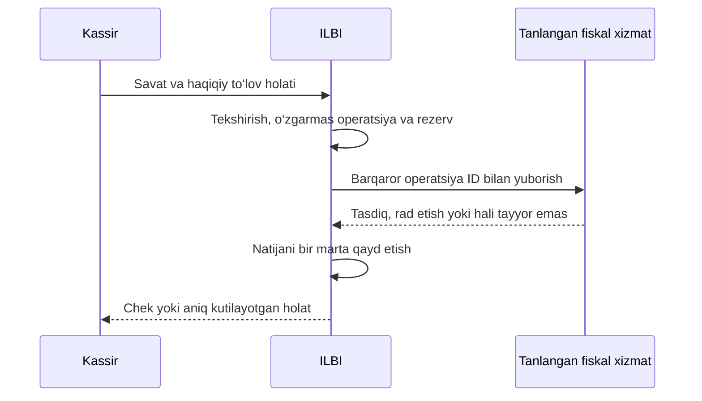

# ILBI — fiskal xizmat va Uzum orqali ulanish qo‘llanmasi

**Tayyorlangan sana:** 2026-10-16, Asia/Tashkent.  
**Holat:** foydalanuvchi qarori bilan keyinga qoldirildi. Keyinchalik ishga tushirish niyati saqlangan.  
**Bog‘liq ish:** [AUD-01 va production tayyorgarligi](LOYIHA_AUDITI_VAZIFALAR.md).

Bu hujjat ishni keyin suhbat tarixini qayta o‘qimasdan davom ettirish uchun yozildi. Unda mavjud kod, tashqi xizmat haqida tekshirilgan ma’lumot va kelajakdagi takliflar ajratilgan. Hujjatning o‘zi Uzum bilan shartnoma, ro‘yxatdan o‘tgan kassa yoki ishlayotgan fiskal integratsiya hisoblanmaydi.

## 1. Hozirgi qaror va uning chegarasi

Foydalanuvchida hozir kartadan to‘lov qabul qiladigan bank terminali bor; alohida rasmiy fiskal chek chiqaradigan kassa yo‘qligi aytildi. Uzum xizmatidan foydalanish ehtimoliy yo‘l sifatida muhokama qilindi. Provayder bilan shartnoma yoki ulanish tasdiqlangani haqida ma’lumot berilmadi.

- **2.1 bajarilgan:** katalog rekvizitlari va yangi chekdagi mahsulot nusxasi saqlanadi.
- **2.2 dastlab ma’qullangan:** do‘kon fiskal ulanishi, sozlash oynasi va alohida boshqarish ruxsati taklif qilingan.
- **Keyingi qaror:** butun fiskal yo‘nalish, jumladan hali boshlanmagan 2.2, hozircha keyinga qoldirildi. Davom ettirish aniq so‘ralmaguncha implementatsiya yoki tashqi ulanish boshlanmaydi.
- Bajarilgan 2.1 ishlari qaytarilmaydi. Boshqa production vazifalari davom etadi.

`SaleService.create_sale()`dagi production cheklovi saqlanadi. Fiskal ishni keyinga qoldirish `DEBUG=True` bilan haqiqiy savdoni ochish yoki ichki nusxani fiskal chek deb chiqarish uchun ruxsat emas. Infratuzilma tayyorligi va haqiqiy chakana POS savdosini ochish alohida tekshiriladi.

## 2. Terminal, ILBI va fiskal xizmatning vazifasi

| Qism | Ushbu loyihadagi vazifa |
|---|---|
| ILBI | Katalog, ombor, savdo, qarz, smena, ruxsatlar va ichki hisobni yuritadi. |
| Bank terminali | Karta to‘lovini qabul qilish vositasi. Uning mavjudligi ILBI fiskal integratsiyasi tayyorligini bildirmaydi. |
| Fiskal provayder | Biz muhokamada virtual kassa/fiskallashtirish xizmatini ILBI’ga dasturiy ulashni taklif etadigan xizmat yoki kompaniyani shunday atayapmiz. |
| Virtual kassa | Savdo ma’lumotini tegishli fiskal jarayonga uzatadigan dasturiy yechim. |
| OFD | Fiskal ma’lumotlar operatori; aniq yechimning operator bilan ishlash tartibi provayderdan aniqlanadi. |
| Chek printeri | Tayyor hujjatni qog‘ozga chiqaradi. Printer sotib olishning o‘zi fiskal integratsiya qilmaydi. |

Masalan, E-POS tashqi savdo dasturlari uchun API orqali fiskal chek, uning holati va qaytarish xizmatlarini taklif qiladi. Bu API orqali ulash tushunchasining misoli; E-POS ILBI uchun tanlangan yoki ulangan deb belgilanmagan. [Provayderning rasmiy tavsifi](https://epos.uz/uz/products/api).

Soliq qo‘mitasi izohida fiskal chek tarkibida sotuvchi nomi/STIR/manzil, kassa identifikatorlari, mahsulot, miqdor, narx, tegishli QQS, to‘lov ma’lumotlari, fiskal belgi va QR kabi rekvizitlar keltirilgan. Alohida chek turlari bo‘yicha istisnolar ham bor; nasiya/bo‘nak oqimiga oddiy sotuv qoidasi avtomatik qo‘llanmaydi. [Soliq qo‘mitasi, 2024-08-22](https://gov.uz/oz/soliq/news/view/19443).

## 3. Kelajakda ILBI’da qanday ishlashi rejalashtiriladi

Bu ILBI uchun taklif etilgan oqim; hali implementatsiya qilinmagan. Aloqa uzilsa, to‘lov qabul qilingan holat o‘chirib yuborilmaydi va yangi ID bilan ko‘r-ko‘rona ikkinchi chek yaratilmaydi. Provayderning tasdiqlangan tartibi bo‘yicha natija tekshiriladi.

ILBI’ning `/r/...` havolasi hozir ichki savdo nusxasini ochadi. Rasmiy fiskal tekshirish havolasi kelajakda alohida saqlanadi. To‘lov uchun QR, ILBI nusxasi uchun QR va fiskal tekshirish QR’i bir maqsadli havola deb qaralmaydi.

## 4. ILBI’da bajarilgan va qolgan qismlar

| Qism | 2026-10-16 holati |
|---|---|
| Sotuvchi profili | Rasmiy nom, soliq identifikatori, ko‘rib chiqish holati va amal qilish muddati mavjud. Ichki tasdiq tashqi kassa ro‘yxati o‘rnini bosmaydi. |
| Do‘kon soliq/chek sozlamalari | QQS maqomi/stavkasi, narx ichida yoki ustiga hisoblash, AOS/foyda solig‘i sozlamalari, chek matnlari va qog‘oz eni mavjud. |
| Mahsulot rekvizitlari | Ixtiyoriy `mxik` va `package_code`; katalog API/formalarida yaratish, tahrirlash va tozalash mavjud. |
| Mahsulot nusxasi | Yangi `SaleItem.product_snapshot` nom, variant, birlik, SKU, kod, shtrix-kod va fiskal rekvizitlarni savdo vaqtida saqlaydi. |
| Chek ko‘rinishi | Saqlangan rekvizitlar 58/80 mm va public nusxada ko‘rsatiladi. Eski satrlarga taxminiy fiskal tarix yozilmagan. |
| Checkout takrorlanishi | Mavjud mahalliy idempotency himoyasi bor. Tashqi provayder kafolatini alohida tekshirish zarur. |
| Do‘kon fiskal ulanishi | Alohida connection modeli, oynasi va `tenants.manage_fiscal_connection` ruxsati hali yo‘q. |
| Provayder adapteri | Uzum yoki boshqa provayderga haqiqiy fiskal yuborish implementatsiya qilinmagan. |
| Nasiya/refund | Mahalliy hisob bor; asl fiskal hujjatga bog‘lash va tashqi operatsiya holatlari qolgan. |
| Ishga tushirish | Haqiqiy sandbox/production kaliti, tashqi tasdiq va pilot dalili yo‘q. |

2.1 tugaganidagi tekshiruv: **628 backend testi**, frontend unit/lint/build, katalog fiskal formalari va chek sozlamalari browser tekshiruvlari o‘tgan. Ikki nullable migratsiya lokal development bazasiga qo‘llanib, oldingi qiymatlar saqlangani tekshirilgan. Bu natijalar tashqi fiskal integratsiya sinovi emas. Tafsilotlar [auditning AUD-01 bo‘limida](LOYIHA_AUDITI_VAZIFALAR.md).

## 5. Uzum bilan birinchi aloqa

Murojaat mavzusi: **ILBI POS uchun Uzum Fiscalization API integratsiyasi**.

Rasmiy [Uzum Bank Partners sahifasida](https://merchants.uzumbank.uz/uz/) ariza shakli va **+998 78 777 07 99** aloqa raqami ko‘rsatilgan. Shu kanal orqali fiskal API uchun mas’ul menejerga yo‘naltirishni so‘rash mumkin. Bu raqam alohida fiskal texnik guruhning bevosita raqami deb tasdiqlanmagan.

Yuborish uchun tayyor matn:

> Assalomu alaykum. Men ILBI nomli do‘kon savdosi va ombor hisobini yurituvchi POS dasturini ishlab chiqyapman. Uni Uzum Fiscalization API xizmatiga ulashni istayman. Do‘konda hozir kartadan to‘lov qabul qiladigan bank terminali bor, alohida fiskal kassa yo‘q.
>
> Naqd va mavjud terminal orqali olingan to‘lovlarni fiskallashtirish mumkinmi? Keyinchalik turli STIRli do‘konlarni ham ILBI orqali ulash rejalashtirilgan. Shartnoma, fiskal xizmat tarifi, kassa ro‘yxati, zarur qurilmalar va sinov uchun API kirishini olish tartibini tushuntirib bersangiz.

Matn hujjat uchun tayyorlangan; agent tomonidan yuborilmagan.

## 6. Shartnomadan oldin olinadigan javoblar

Quyidagilarni menejer/texnik guruhdan yozma ravishda aniqlashtirish tavsiya etiladi. Bular Uzum allaqachon qabul qilgan shartlar emas.

1. **Mavjud terminal:** boshqa bank terminali orqali to‘langan savdoni xizmat qabul qiladimi? Qaysi tranzaksiya rekvizitlari kerak? Pulni qayta yechish talab qilinmasligi qanday ta’minlanadi?
2. **Naqd savdo:** ILBI orqali naqd to‘lovni fiskallashtirishning amaliy ulash sharti qanday?
3. **Ko‘p sotuvchi:** bitta ILBI platformasidan turli egalar/STIRlar uchun ishlash mumkinmi? Kalit va kassa qaysi sotuvchi/do‘kon doirasida ishlaydi?
4. **Kassa ro‘yxati:** virtual kassa, fiskal modul va TXKM bo‘yicha kim nima qiladi? Ro‘yxatdan o‘tgan yechimning nomi/versiyasi va ILBI bilan ishlash tartibi qanday tasdiqlanadi?
5. **Qurilma:** mavjud terminalni saqlash mumkinmi? Mahalliy agent, alohida qurilma yoki printerga qanday talab bor?
6. **Narx:** ulash, har kassa, oylik xizmat, chek va texnik yordam uchun narxlar qanday? Fiskal xizmat tarifi to‘lov qabul qilish tarifidan alohida olinadi.
7. **Nasiya/bo‘nak:** dastlabki savdo va keyingi to‘lov qanday hujjatlarga bog‘lanadi? ILBI’dagi do‘kon nasiyasi bilan alohida muddatli to‘lov mahsuloti aralashtirilmaydi.
8. **Qaytarish:** qisman/to‘liq refund, qisman to‘langan nasiya, boshqa smenadagi qaytarish va asl to‘lov turiga talablar qanday?
9. **Noaniq natija:** timeout, HTTP 202, vaqtinchalik 404 va bir operation ID bilan takroriy yuborish nimani anglatadi? Natijani qachon va qanday tekshirish kerak?
10. **Mahsulot:** MXIK/qadoq juftligi, kasr miqdor, soliq imtiyozi, markirovka va cheklangan tovarlar qanday tekshiriladi?
11. **Texnik shartnoma:** amaldagi OpenAPI versiyasi, limitlar, autentifikatsiya, zarur webhooklar va ularning imzosi qanday?
12. **Ishga tushirish:** testlarni kim qabul qiladi, production kaliti qachon beriladi, xizmat uzilganda yordam va offline tartibi qanday?

Soliq qo‘mitasi reyestrlar o‘zgarishi mumkinligini va amaldagi ro‘yxatni tekshirishni eslatadi. Avvalgi tekshiruvlarda OFD reyestri sahifasi ochilmagani uchun muayyan yechimning joriy maqomi tasdiqlangan deb hisoblanmagan. Ishni davom ettirganda qayta tekshiriladi. [Soliq qo‘mitasi, 2026-04-28](https://gov.uz/oz/soliq/news/view/159141).

## 7. Siz tayyorlaydigan ma’lumotlar

| Kim | Tayyorlanadigan ma’lumot |
|---|---|
| ILBI operatori | Platforma haqida qisqa tavsif, domen, bog‘lanish shaxsi, birinchi pilot do‘kon va rejalashtirilgan ko‘p do‘konli ishlash. |
| Sotuvchi/do‘kon egasi | Rasmiy nom, STIR yoki tegishli identifikator, do‘kon manzili, soliq maqomi va mavjud terminal haqida ma’lumot. |
| Buxgalter/mas’ul xodim | Tovar va birlikka mos MXIK/qadoq, tegishli soliq stavkalari/imtiyozlari, nasiya va qaytarish amaliyoti. |
| Texnik taraf | Server muhiti va sinov rejasi; kalitlarni saqlash/yangilash, kuzatuv va xatolarni boshqarish tartibi. |

Uzum Partners’ning umumiy hamkorlik FAQ’ida bank rekvizitlari, ro‘yxat guvohnomasi, rahbarning identifikatsiya hujjati, tegishli tayinlash hujjati, logotip va aloqa ma’lumoti sanalgan. **Aynan fiskal xizmat va ILBI hamkorligi uchun** kerakli hujjatlar ro‘yxatini menejer tasdiqlaydi. [Rasmiy hamkorlik FAQ’i](https://merchants.uzumbank.uz/uz/).

Shaxsiy hujjat, API kaliti, E-imzo kaliti va parollar ushbu Markdown, Git yoki ochiq yozishmaga joylanmaydi. Ular kerak bo‘lsa tegishli rasmiy kanal va serverdagi maxfiy sozlash tartibi ishlatiladi.

## 8. Uzum rasmiy hujjatida ko‘rilgan ulanish tartibi

Uzum yo‘riqnomasida menejerdan API kaliti olish, MXIK/qadoq ma’lumotlarini tayyorlash, test integratsiyasi va tasdiqdan keyin production kalitini olish ko‘rsatilgan. Autentifikatsiya `X-API-Key` orqali. Hujjatdagi test hosti `https://test-ofd.ipt-merch.com`, production hosti `https://ofd-key.inplat-tech.com`. Ishni qayta boshlaganda bu manzillar tekshiriladi. [Uzum Fiscalization yo‘riqnomasi](https://developer.uzumbank.uz/en/fiscalization/).

Rasmiy spetsifikatsiyada ko‘rilgan asosiy yo‘llar:

| Amal | Tekshirilgan OpenAPI yo‘li |
|---|---|
| Savdoni yuborish | `POST /v2/receipt` |
| Qaytarish | `POST /v2/refund_receipt` |
| Chek havolasini olish | `GET /v2/receipt/{operation_id}/receipt_url` |

OpenAPI 0.0.2’da operatsiya uchun UUID, vaqt, naqd/karta summalari va mahsulot satrlari bor. Pul qiymatlari tiyinda butun son, MXIK/qadoq kodlari matn sifatida beriladi. ILBI’ning `Decimal` summalari bilan moslash va yaxlitlash adapterda tekshiriladi. [Rasmiy OpenAPI fayli](https://developer.uzumbank.uz/en/redocusaurus/en_fiscalization.yaml).

Uzum matnida bo‘nak/kredit uchun alohida kelishuv va fiskal QR/belgisiz hujjat holati ham ko‘rsatilgan. Do‘kon nasiyasi oqimi provayder bilan tasdiqlanmasdan oddiy naqd/karta savdosiga aylantirilmaydi. [Rasmiy izoh](https://developer.uzumbank.uz/en/fiscalization/).

### Spetsifikatsiyadagi ochiq farqlar

2026-10-16dagi tekshiruvda OpenAPI GET yo‘li bilan testing matnidagi yo‘l tartibi bir xil emas edi. Matnda `labels` markirovka maydoni tilga olingan, ammo tekshirilgan `ReceiptDataItem` schemasida u yo‘q edi. Spetsifikatsiyada `servers` ham berilmagan. Amaldagi shartnoma provayder bilan aniqlashtiriladi; hujjatdagi marketing misolidan taxminiy adapter yaratilmaydi. [OpenAPI 0.0.2](https://developer.uzumbank.uz/en/redocusaurus/en_fiscalization.yaml), [API sahifasi](https://developer.uzumbank.uz/en/fiscalization/).

## 9. ILBI’da qolgan texnik ishlar

Quyidagilar loyiha takliflari; hali tayyor funksiyalar emas.

### 9.1. Do‘kon fiskal ulanishi — 2.2

Har do‘kon uchun sotuvchi/provayder, muhit, ro‘yxatdan o‘tgan kassa rekviziti va tekshirish holatini alohida yuritish. **Xizmatlar & Sozlamalar**da oynasi va `tenants.manage_fiscal_connection` ruxsati qo‘shilishi rejalashtirilgan. Bu ruxsat seller review yoki haqiqiy savdoni ochish vakolatini bermaydi. Foydalanuvchi ulanishni qo‘lda tasdiqlangan deb yoqa olmaydi; muhim rekvizit almashsa qayta tekshirish kerak bo‘ladi.

### 9.2. Operatsiya, rezerv va yuborish

- Savdo va fiskal operatsiya holati ajratiladi.
- Barqaror operation ID, so‘rov tarkibining nusxasi va takroriy yuborish himoyasi bo‘ladi.
- DB tekshiruvi/rezerv va yuborish yozuvi atomik yaratiladi; tarmoq so‘rovi stock/pul locklarini ushlab turmaydi.
- Holatlar kamida tayyorlandi, yuborilmoqda, tasdiqlandi, aniq rad etildi va natija noma’lumni farqlaydi.
- Tashqi natija DBga bir marta qo‘llanadi. Worker qayta ishga tushishi dublikat chek yoki takroriy stock/pul harakati qilmasligi kerak.

### 9.3. Soliq, mahsulot va to‘lov

Do‘kon soliq sozlamalariga qo‘shimcha ravishda mahsulotga xos imtiyoz/stavka, MXIK/qadoq mosligi va zarur markirovka oqimi aniqlanadi. AOS va foyda solig‘i xaridorga QQS sifatida qo‘shilmaydi. Integratsiya soliq deklaratsiyasi topshirish yoki soliqni to‘lash funksiyasi sifatida rejalashtirilmagan.

Haqiqiy to‘lov dalili bilan fiskal natija alohida yuritiladi. Terminaldagi to‘lov bekor qilinishi va fiskal qaytarish o‘zaro moslashtiriladi. Biri o‘tdi, ikkinchisi o‘tmadi holati yashirilmaydi.

### 9.4. Nasiya va qaytarish

Hozir `DebtPayment` kontragentga bog‘langan; asl savdolarga taqsimot yo‘q. Kelajakdagi qarz to‘lovi tegishli hujjatlarga bog‘lanadi. Eski umumiy qarzdan qaysi chek to‘langanini taxmin qilib yozish mumkin emas.

Refund asl fiskal chek, qaytarilgan satr/miqdor, tarixiy soliq va real to‘lov turiga bog‘lanadi. Mahsulotning hozirgi narxi yoki QQS’i eski qaytarishni qayta hisoblash uchun ishlatilmaydi. Oddiy savdo gate’idan tashqarida qolayotgan refund/qarz to‘lovlari ham alohida ko‘rib chiqiladi.

### 9.5. Kalit va kuzatuv

Maxfiy kalit frontendga yoki public chek javobiga kirmaydi. Loglarda to‘liq autentifikatsiya headeri, maxfiy kalit va ortiqcha mijoz ma’lumoti bo‘lmaydi. Kuzatuv uchun operatsiya IDsi, holat, vaqt va cheklangan xato kodi yetarli bo‘lishi ko‘zda tutiladi. Kalitni almashtirish, provayderga kirish yo‘qolishi va uzoq kutilayotgan operatsiyalar uchun boshqarish tartibi yoziladi.

## 10. Ishga tushirishdan oldingi qabul sinovlari

| Holat | ILBI uchun kutiladigan natija |
|---|---|
| Oddiy naqd/karta savdosi | Tasdiqlangan shartnoma bo‘yicha bitta operatsiya va mos chek; summa/to‘lov mos. |
| Bir savatni takror yuborish | Dublikat fiskal chek, stock harakati yoki qarz yozuvi yo‘q. |
| Bir ID, boshqa savat | Qarama-qarshi so‘rov rad etiladi. |
| Timeout yoki 202 | Soxta muvaffaqiyat ko‘rsatilmaydi; natija aniqlashtiriladi. |
| Vaqtinchalik 404 | Provayder kafolatisiz yangi operatsiya yaratilmaydi. |
| Worker/server qayta ishga tushishi | Saqlangan holatdan davom etadi; qo‘llangan natija takror qo‘llanmaydi. |
| To‘liq/qisman refund | Asl chek, miqdor, summa, soliq va tenderga mos. |
| Nasiya/keyingi to‘lov | Kelishilgan hujjat turi va asl hujjat bog‘lanishi saqlanadi. |
| Noto‘g‘ri/mavjud bo‘lmagan rekvizit | Aniq xato; taxminiy MXIK yoki soxta tasdiq yaratilmaydi. |
| Boshqa do‘kon yoki STIR | Ruxsatsiz ulanish/chek ma’lumoti ochilmaydi. |
| Uzilish va tiklanish | Noaniq operatsiyalar hisoboti va qayta tekshirish ishlaydi. |
| Chek ko‘rinishi | Tasdiqlangan rekvizitlar to‘liq; ichki nusxa va fiskal hujjat farqlanadi. |

Mahalliy testlar, provayder sandboxi va production tasdig‘i uch xil dalildir. Birining o‘tishi qolganlari ham bajarildi degani emas.

## 11. Keyinchalik davom ettirish ro‘yxati

1. Ushbu hujjat va AUD-01ni qayta o‘qish; joriy koddagi tugallangan qismlarni tekshirish.
2. Uzum yoki boshqa tanlangan provayderning amaldagi imkoniyati, maqomi va shartlarini qayta tekshirish.
3. Menejerning yozma javoblari va amaldagi OpenAPI versiyasini qayd etish; maxfiy qiymatlarni hujjatga kiritmaslik.
4. Birinchi pilot do‘kon, sotuvchi va ro‘yxatdan o‘tgan kassani aniqlash.
5. Foydalanuvchi bilan ishni davom ettirishni kelishish; avvalgi rozilikdan keyingi keyinga qoldirish qarorini chetlab o‘tmaslik.
6. 2.2 va keyingi texnik qismlarni birma-bir bajarish.
7. Test/sandbox dalillari, nasiya/refund hamda uzilish holatlarini tekshirish.
8. Tashqi tasdiq va production kirishini olish; alohida kelishilgan pilotdan boshlash.

**Hozirgi amaliy yo‘nalish:** fiskal ishlarni shu holatda saqlab, production infratuzilmasi, zaxiralash/tiklash va qolgan audit topilmalari ustida ishlash.
