# Do‘kon egasi: rasmli ish yo‘riqnomasi

Yangilangan: **2026-10-14**. Rasmlar amaldagi interfeysdan, sun’iy demo ma’lumotlar bilan olingan. Strelka yonidagi raqam shu rasm ostidagi qadamni ko‘rsatadi. Rasmni bosib kattalashtirish mumkin.

## 1. Ishni to‘g‘ri do‘kondan boshlang

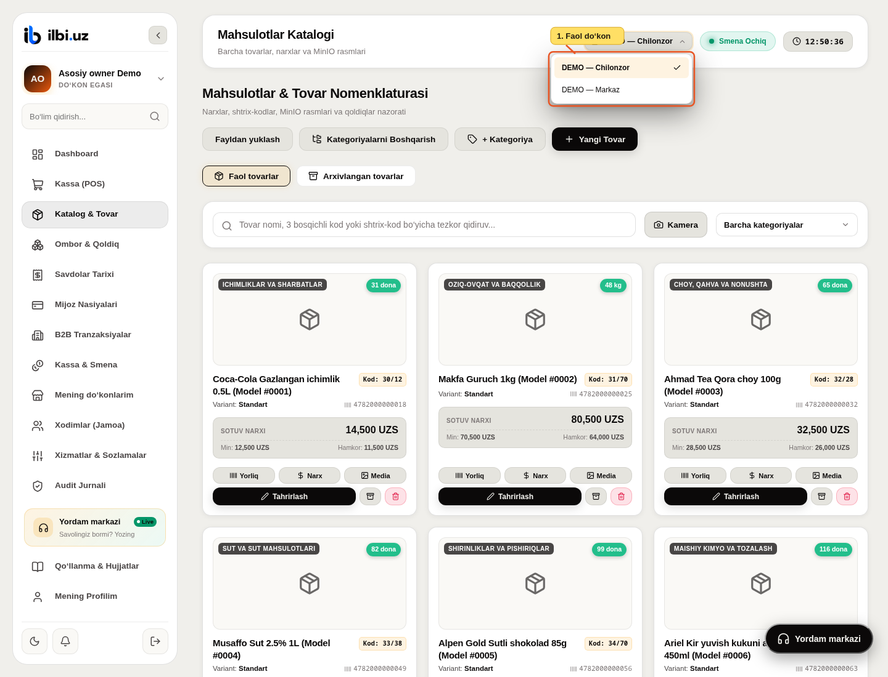

1. Yuqoridagi do‘kon nomini bosing va ishlayotgan do‘koningizni tanlang.
2. Katalog, ombor, qarz va kassadagi ma’lumotlar shu tanlovga bog‘liq. Amal qilishdan oldin nomni tekshiring.

Yangi sotuvchi profilini **Mening do‘konlarim**dan yuboring. Profil tasdiqlanishi, amal qilish muddati va do‘konga bog‘langanini tekshiring.

## 2. Mahsulot yaratish

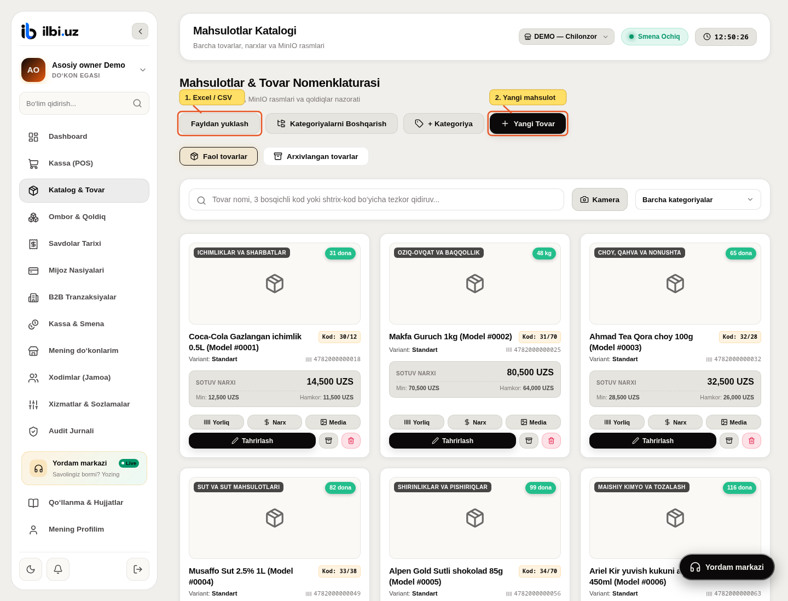

1. Ko‘p tovarni birga kiritish uchun **Fayldan yuklash**ni tanlang.
2. Bitta yangi tovar uchun **Yangi Tovar**ni bosing.

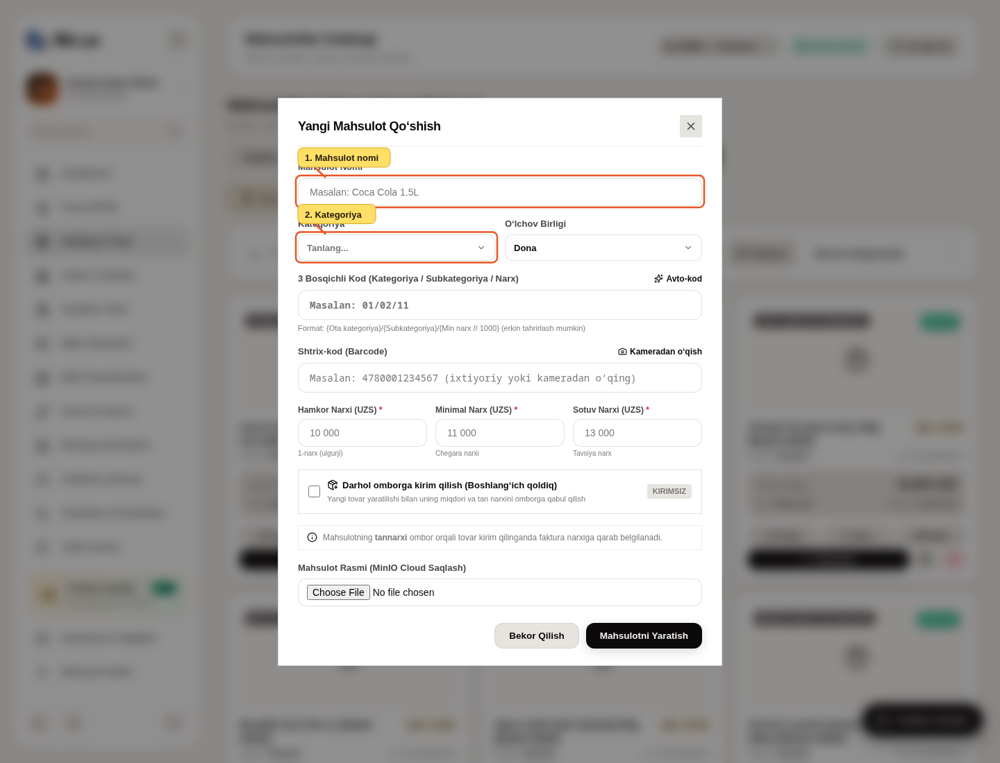

1. Mahsulot nomini yozing.
2. Kategoriyani tanlang. Birlik, hamkor, minimal va sotuv narxlarini tekshiring. Boshlang‘ich qoldiq kerak bo‘lsa, kirim tanlovini yoqib miqdor va tannarx kiriting; aks holda tovar omborsiz yaratiladi.
3. **Mahsulotni Yaratish**ni bosing va katalogdan natijani tekshiring.

## 3. Excel/CSV import

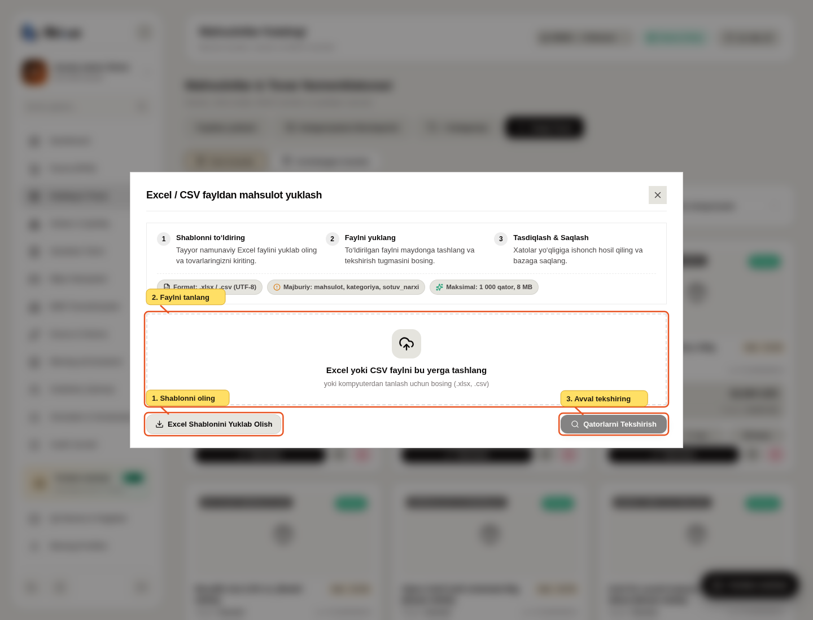

1. **Shablonni yuklash**ni bosing va aynan shu ustunlardan foydalaning.
2. To‘ldirilgan faylni tanlang. Limit: 1 000 qator, 8 MB. Sana `YYYY-MM-DD`, shtrix-kod matn ko‘rinishida bo‘lsin.
3. **Qatorlarni tekshirish**ni bosing. Xatolarni faylda tuzatib qayta yuklang. Tekshiruv muvaffaqiyatli bo‘lgach **Tasdiqlash va saqlash**ni bosing. Tekshirishning o‘zi katalogga yozmaydi.

## 4. Shtrix-kod yorlig‘i

Mahsulot kartasidagi **Yorliq chop etish**ni bosing.

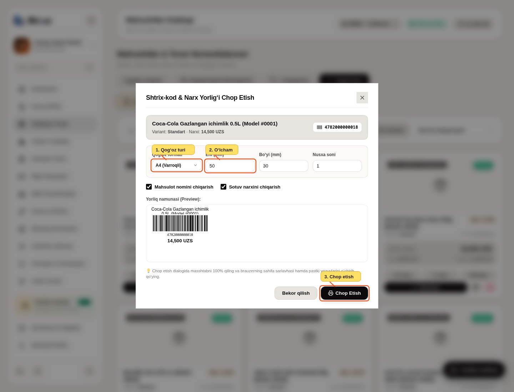

1. A4 yoki yorliq printerini tanlang.
2. Eni, bo‘yi va nusxalar sonini kiriting. Faqat shtrix-kod kerak bo‘lsa nom va narx belgilashlarini o‘chiring.
3. Namunani tekshirib **Chop etish**ni bosing. Brauzerda 100% masshtabni qo‘llang.

## 5. Tovar kirimi va partiyalar

**Ombor → + Tovar Kirimi**ni oching.

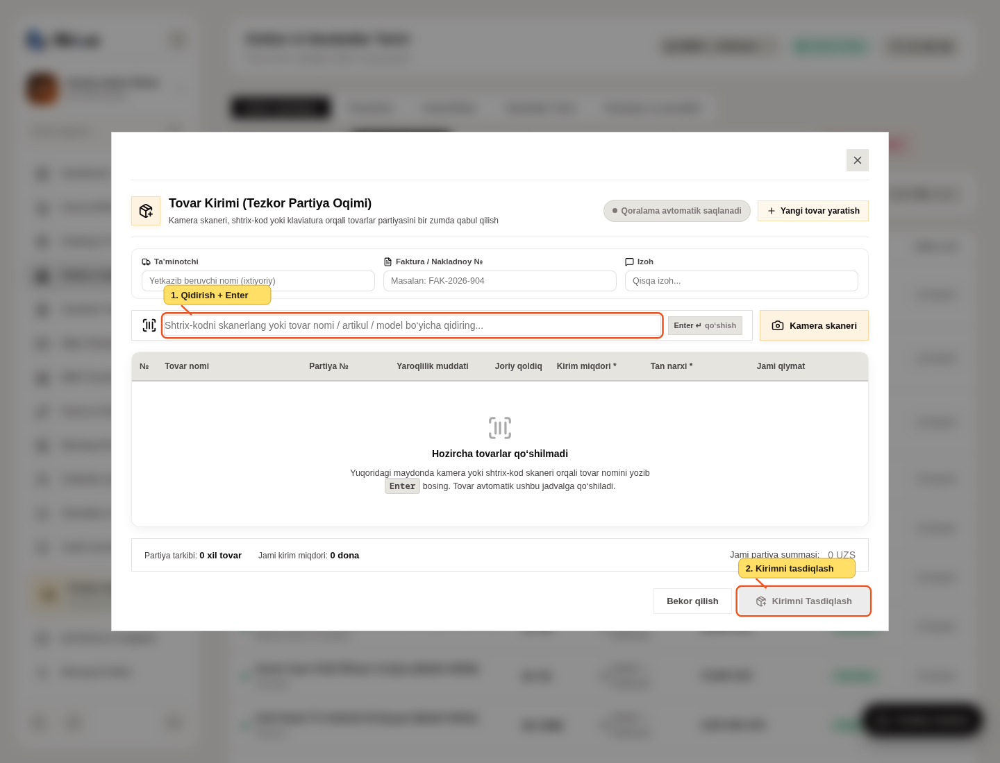

1. Tovarni skanerlang yoki nomini yozib **Enter** bosing. Qatordagi miqdor va tannarxni fakturaga mos kiriting. Kerak bo‘lsa partiya va yaroqlilik sanasini yozing.
2. Qatorlar va jami summani tekshirib **Partiyani Tasdiqlash**ni bosing. “Qoralama saqlandi” yozuvi kirim omborga o‘tdi degani emas.

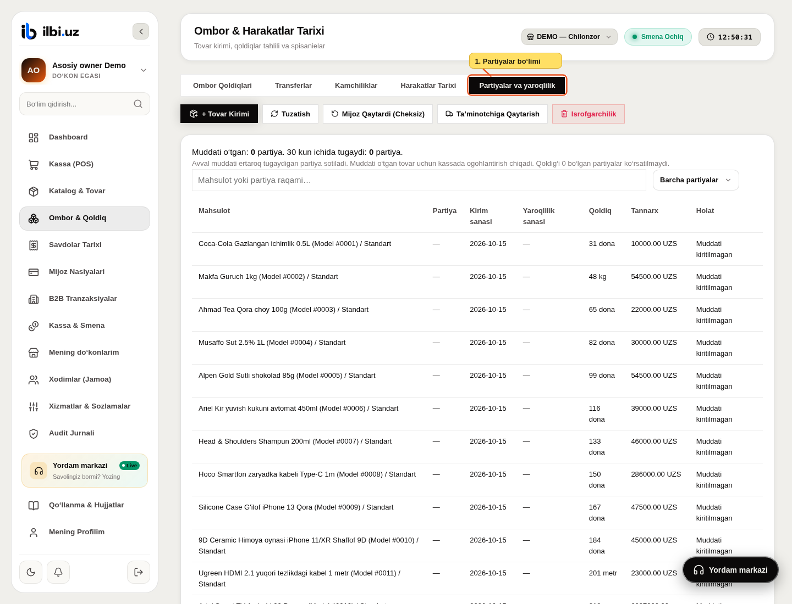

1. **Partiyalar va yaroqlilik**ni ochib, kerakli mahsulot va muddat filtrini tanlang. Muddati o‘tgan yoki yaqinlashayotgan partiyalarni tekshiring.

Bir sotuvchining do‘konlari orasidagi ko‘chirish **Transferlar** orqali; boshqa sotuvchiga savdo **B2B** orqali yuritiladi. Qabul/rad etish va jismoniy qaytarish alohida amallar: rad etish tovar jismonan qaytdi degani emas.

## 6. POS’da to‘lovga o‘tish

Bu misol demo muhitidan. Hozir production POS fiskal integratsiya tayyor bo‘lguncha yopilgan; chakana chek UZS bilan yuritiladi.

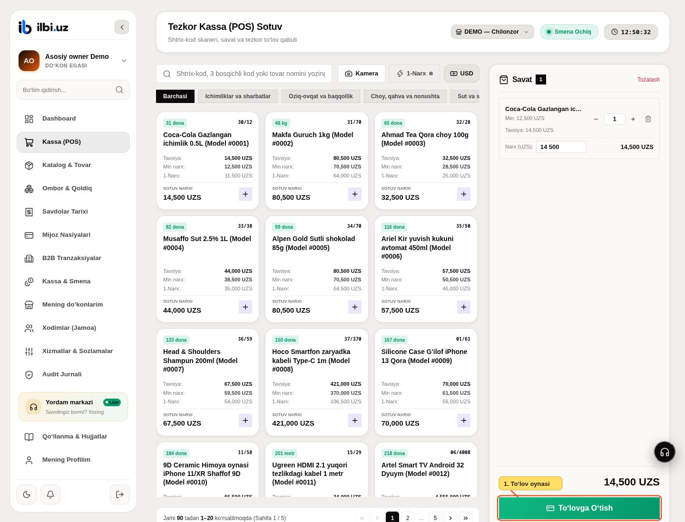

1. Skaner yoki qidiruv bilan tovar qo‘shing. Savatdagi mahsulot, miqdor va narxlarni tekshirib **To‘lovga O‘tish**ni bosing.

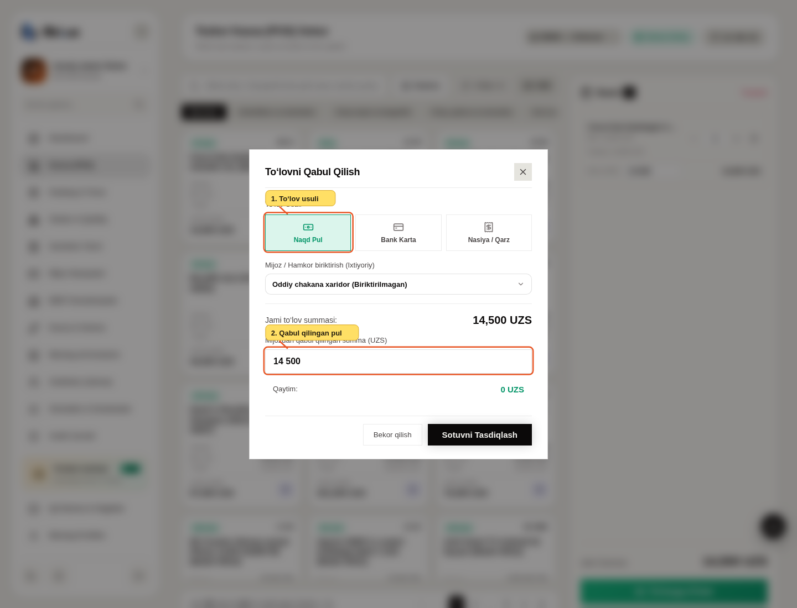

1. Haqiqiy to‘lov usulini tanlang: naqd, karta yoki nasiya. Nasiya bo‘lsa mijozni tanlang.
2. Naqd to‘lovda olingan summani kiriting, qaytimni tekshiring va tasdiqlang. USD kalkulyatori alohida hisoblash vositasi.

**Savdolar**dan chek tafsilotini ochish, chiqarish va tegishli vakolat bilan 7 kun ichida sababli to‘liq/qisman qaytarish mumkin. Xatoda yangi savdo kiritishdan oldin tarixni tekshiring.

## 7. Qarz to‘lovi

**Qarzlar**dan mijozni topib **Qarz To‘lash**ni bosing.

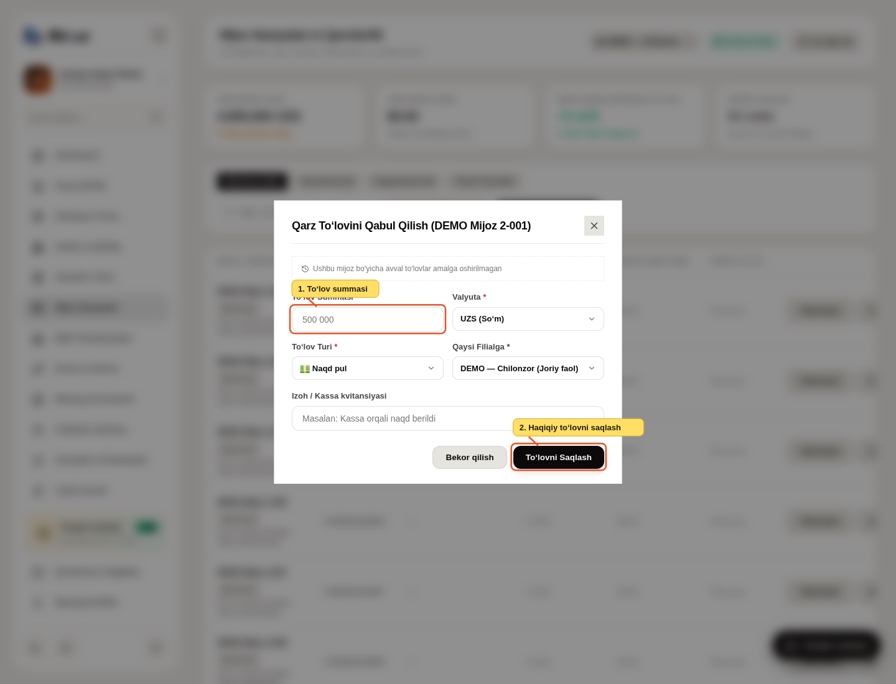

1. Haqiqiy olingan summani kiriting; valyuta, naqd/karta va pul tushgan do‘konni tekshiring.
2. **To‘lovni Saqlash**ni bosing va tarixga yozilganini tekshiring. Bu amal ruxsatli xodimga ham berilishi mumkin; tuzatish egaga tegishli.

## 8. Smenani yopish

**Kassa & Smena → Smenani Yopish (Z-Report)**ni oching.

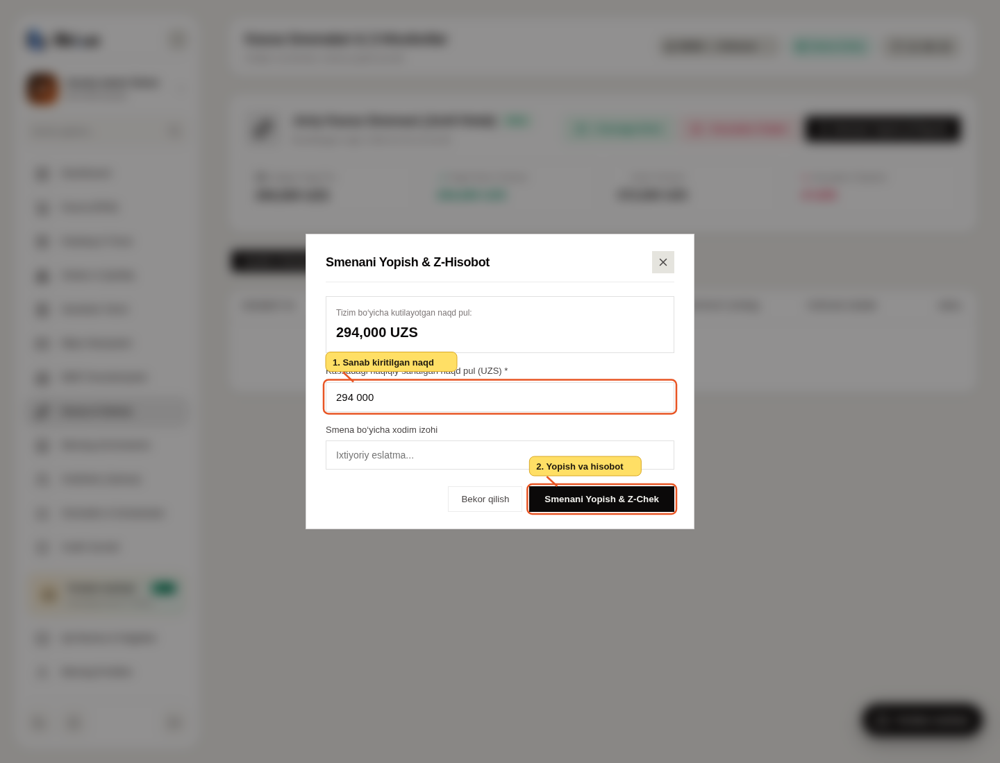

1. Kassadagi haqiqiy naqdni sanab kiriting. Tafovut chiqsa sababini yozing.
2. **Smenani Yopish & Z-Chek**ni bosing va hisobotni tekshiring. Telegramga yuborish do‘kon sozlamalariga bog‘liq.

## 9. Xodim va yordam

**Xizmatlar & Sozlamalar → Chek va soliqlar** bo‘limida do‘konning soliq rejimi, QQS maqomi va stavkasi,
narxga QQS kiritilganligi yoki ustiga qo‘shilishi, AOS hamda foyda solig‘i sozlanadi. AOS va foyda solig‘i
sotuvchining sozlamalari sifatida saqlanadi; xaridor to‘loviga qo‘shilmaydi va bitta chekdan hisoblanmaydi.
Chekning manzili, telefon va matnlari, 58/80 mm qog‘ozi, kassir/mijoz nomi va mahsulot bo‘yicha QQS ko‘rinishi
ham shu yerda boshqariladi. STIR va rasmiy nom biriktirilgan sotuvchi profilidan olinadi.

Saqlashdan oldin jonli namunani tekshiring. O‘zgarishlar yangi savdolarga qo‘llanadi; eski savdoning summalari
va saqlangan chek sozlamalari o‘zgarmaydi. Soliq ma’lumoti saqlanmagan eski cheklar qayta hisoblanmaydi.
Bu sozlamalar fiskal provayderga ulanishni almashtirmaydi.

Xodimga boshqarishni topshirish uchun ruxsatlar ichidagi **Do‘kon sozlamalarini boshqarish**
(`tenants.manage_settings`)ni bering. Bu ruxsat chek/soliq, kurs va bildirishnoma sozlamalariga,
shu jumladan sozlangan hisobotlarni qo‘lda jo‘natishga ham amal qiladi; boshqa do‘konga kirish bermaydi.

1. **Xodim qo‘shish** orqali shaxsiy telefon, lavozim va zarur ruxsatlarni belgilang.
2. Email mavjud bo‘lsa **Emailga yuborish** orqali xavfsiz taklifni yuboring. Ruxsat tahriri, bloklash, arxivlash va ishdan bo‘shatish tugmalarini vazifasiga mos ishlating.

**Yordam markazi** orqali o‘zbekcha, ruscha yoki inglizcha murojaat yozishingiz va zarur skrinshotni yuborishingiz mumkin. Operator: **+998 77 021 21 49**, **@abdulxadiy_0**. AI hozircha ulanmagan.
