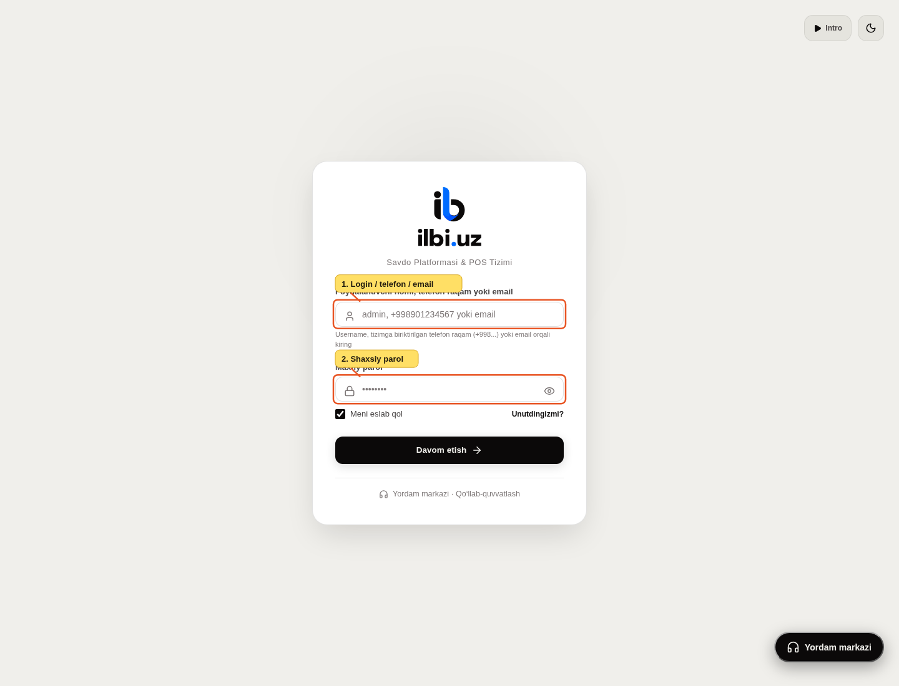
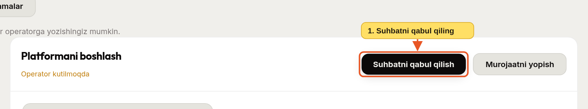
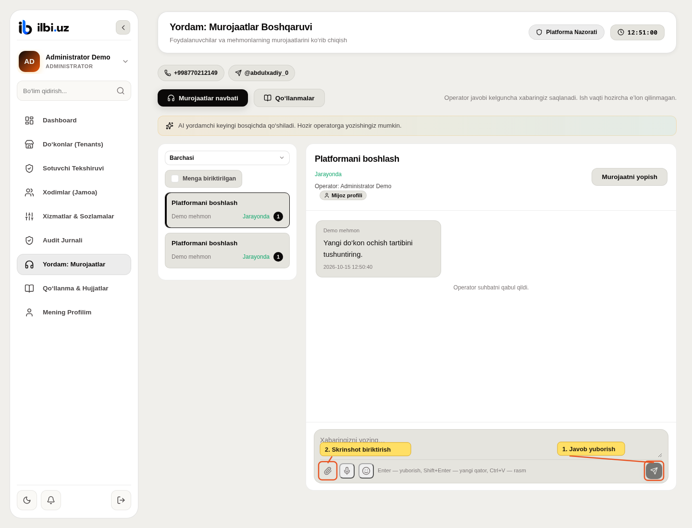
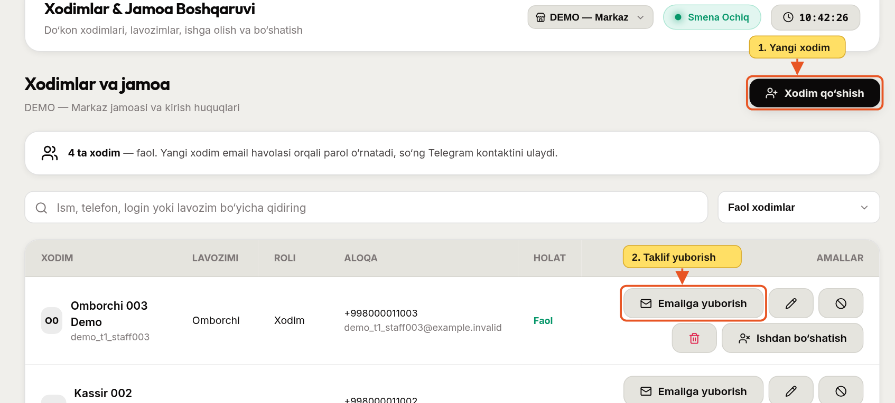

# Administrator: boshqaruv va operatorning rasmli yo‘riqnomasi

Yangilangan: **2026-10-16**. Rasmlar avvalgi asosiy oqimlardan, faqat sun’iy demo ma’lumotlar bilan olingan. Yangi admin amallari 6–8-bo‘limlarda. Kattalashtirish uchun rasmni bosing.

## 1. Kirish

1. Shaxsiy username, telefon yoki emailni kiriting.
2. Parol va Telegramdan kelgan OTP’ni kiriting. Admin ham umumiy kirish himoyalariga bo‘ysunadi.

## 2. Do‘kon va sotuvchi

1. **Do‘konlar (Tenants)**dan do‘kon va egani yarating. Emailni tekshiring; taklif havolasi shu manzilga yuboriladi.
2. Mavjud do‘konning egasini almashtirish yoki faolligini o‘zgartirishdan oldin aynan to‘g‘ri do‘konni tanlaganingizni tekshiring.
3. **Sotuvchi Tekshiruvi**dan yuborilgan profillarni ko‘ring. Tasdiqlashda kelajakdagi muddatni, rad etishda aniq sababni kiriting.

Bitta egada bir nechta do‘kon bo‘lishi mumkin. Tasdiqlangan sotuvchi profili fiskal integratsiya o‘rnini bosmaydi. Production chakana POS hozir yopilgan.

## 3. Yordam navbatidan suhbatni olish

**Yordam: Murojaatlar**ni oching. Holat filtri bilan kutilayotgan murojaatlarni tanlang; **Menga biriktirilgan** orqali o‘zingiz olganlarini ko‘ring.

1. Mavzu, til va yozishmalarni o‘qib **Suhbatni qabul qilish**ni bosing. Boshqa operator avvalroq olgan bo‘lsa, tizim buni bildiradi.

1. Javobni yozib **Yuborish**ni bosing. Suhbat tili foydalanuvchi tanlovida ko‘rsatiladi.
2. Tushuntirish uchun rasm kerak bo‘lsa **Rasm qo‘shish**ni tanlang. PNG/JPEG/WebP, 2 MB gacha.
3. Masala tugagach **Murojaatni yopish**ni bosing. Qayta ochilgan suhbat yana kutilayotgan navbatga tushadi.

Telegramdagi havola faqat panelga olib keladi; javob shu yerda yoziladi. Operatorga keladigan bildirishnomada suhbat matni va rasmlar bo‘lmaydi. Chat foydalanuvchisidan parol yoki OTP so‘ramang.

## 4. Xodimni boshqarish

1. **Xodim qo‘shish**ni tegishli do‘kon va vakolat doirasida ishlating.
2. Hisob emaili to‘g‘ri bo‘lsa taklif havolasini yuboring. Bloklash, arxivlash, tiklash va bo‘shatish turli amallar; tarixni saqlagan holda keraklisini tanlang.

Bloklangan hisobni ochishdan oldin shaxs va murojaatni tekshiring. Mehmon chatidagi ism tasdiqlangan hisob ma’lumoti emas.

## 5. Qo‘llanmani yangilash

1. **Qo‘llanma & Hujjatlar**dan kerakli rol qo‘llanmasini oching.
2. **Qo‘llanmani Tahrirlash**ni bosing; faqat amaldagi jarayonni yozing.
3. Matnni saqlang va oddiy o‘quvchi ko‘rinishida tekshiring. Rasmga bosilganda kattalashtirish ochilishini tekshiring.

Bitta rasm bitta vazifani tushuntirsin. Kichik tugma uchun butun ekran tasvirini ishlatmang. Raqam va strelkalar matndagi qadamga mos bo‘lsin. Rasmga haqiqiy mijoz, telefon, token yoki maxfiy hisobot tushmasin.

## 6. Boshqaruv paneli va barcha hisoblar

**Boshqaruv paneli** platformaning umumiy holatini ko‘rsatadi: hisoblar, faol/bloklangan do‘konlar, kutayotgan yordam murojaatlari va sotuvchi tekshiruvlari. Kartaga bosib tegishli bo‘limga o‘ting. So‘nggi ma’muriy amallar auditdan olinadi.

**Hisoblar & Kirish**da ism, username, telefon yoki email orqali qidiring. Rol va faollik filtrini qo‘llang. Hisobning do‘konlari tugmasidan tegishli jamoaga o‘ting. Yangi do‘kon egasi **Do‘konlar**, xodim esa **Xodimlar (Jamoa)** orqali yaratiladi; mavjud hisobni takroran yaratish shart emas.

Hisobni bloklash barcha do‘konlardagi kirishga ta’sir qiladi. Sabab va o‘z admin parolingiz talab qilinadi; tarix o‘chmaydi. Administrator hisobini bu oynadan bloklash mumkin emas. Jamoaning a’zoligi, ruxsatlari, arxivlash va ishdan bo‘shatish o‘z amallari bilan boshqariladi.

## 7. Login raqami va Telegramni qo‘lda yangilash

Bu amalni faqat **platforma admini** bajaradi. Xodimni odatdagi tahrirlash oynasidagi **aloqa raqami** login va Telegramni o‘zgartirmaydi.

1. Avval murojaatchining hisob egasi ekanini va yangi raqamga egaligini tekshiring. Mehmonning ism/telefon yozgani buning isboti emas; undan parol yoki OTP so‘ramang.
2. **Hisoblar & Kirish**da to‘g‘ri hisobni topib kalit belgisini bosing. Shu tugma admin uchun xodimlar ro‘yxatida ham bor.
3. Yangi login telefon raqamini va shaxsiy Telegram chat ID sini kiriting. Chat IDni botdagi `/status`dan oling. Guruh ID si login uchun yaramaydi.
4. Telegramni butunlay uzib, keyin botdan qayta ulash kerak bo‘lsa, tegishli katakni belgilang.
5. Sababni yozing, egalik tekshirilganini belgilang va **o‘zingizning administrator parolingizni** kiriting. **Tekshirib yangilash**ni bosing.

Hisob IDsi, do‘konlardagi a’zolik va savdo tarixi qoladi. Eski sessiyalar/parol havolalari bekor bo‘ladi; foydalanuvchi qayta kiradi. Boshqa hisob egallagan telefon yoki Telegram avtomatik tortib olinmaydi. Hisob boshqa oynada yangilangan bo‘lsa, uni qayta ochib tekshiring. O‘z admin hisobingizni o‘zgartirsangiz, siz ham tizimdan chiqasiz; yangi ma’lumot bilan qayta kiring.

Tiklash amali sabab va admin bilan platforma auditida qayd etiladi. O‘zgartirish tugmasini bosishdan oldin hisobni ikki marta tekshiring.

## 8. Yordam xabarlarini Telegramda olish

1. **Xizmatlar & Sozlamalar → Platforma bildirishnomalari**ni oching. Do‘kon tanlash talab qilinmaydi.
2. **Telegram orqali xabardor qilish**ni yoqing.
3. Shaxsiy chat, guruh yoki ikkalasini tanlang. Shaxsiy chat uchun adminning login raqami botga ulangan bo‘lishi kerak. Guruh uchun botni qo‘shib, yozish ruxsatini bering va manfiy raqamli guruh chat ID sini kiriting.
4. Sozlamalarni saqlang. **Sinov xabari**ni bosib, Telegramdan kelganini tekshiring. “Navbatga qo‘yildi” tasdiq xabarni yetkazib bo‘ldi degani emas.

Yangi yordam murojaati yoki mijozning keyingi xabari uchun xabarnoma va murojaat havolasi keladi. Suhbat matni, rasm va maxfiy ma’lumotlar Telegramga ko‘chirilmaydi; javobni yordam markazida yozing. Admin qo‘ng‘iroqchasi o‘qilmagan yordam xabarlarini ko‘rsatadi va murojaatlar oynasini ochadi.

Bildirishnomani o‘chirib saqlasangiz, ushbu tanlov qo‘llanadi. Interfeysda Telegram sozlamasi saqlangach serverdagi eski qabul qiluvchilar ro‘yxati zaxira manzil sifatida ishlatilmaydi. Telegram kelmasa bot ulanishi, guruh huquqi va serverdagi fon vazifalari ishlayotganini tekshiring.
