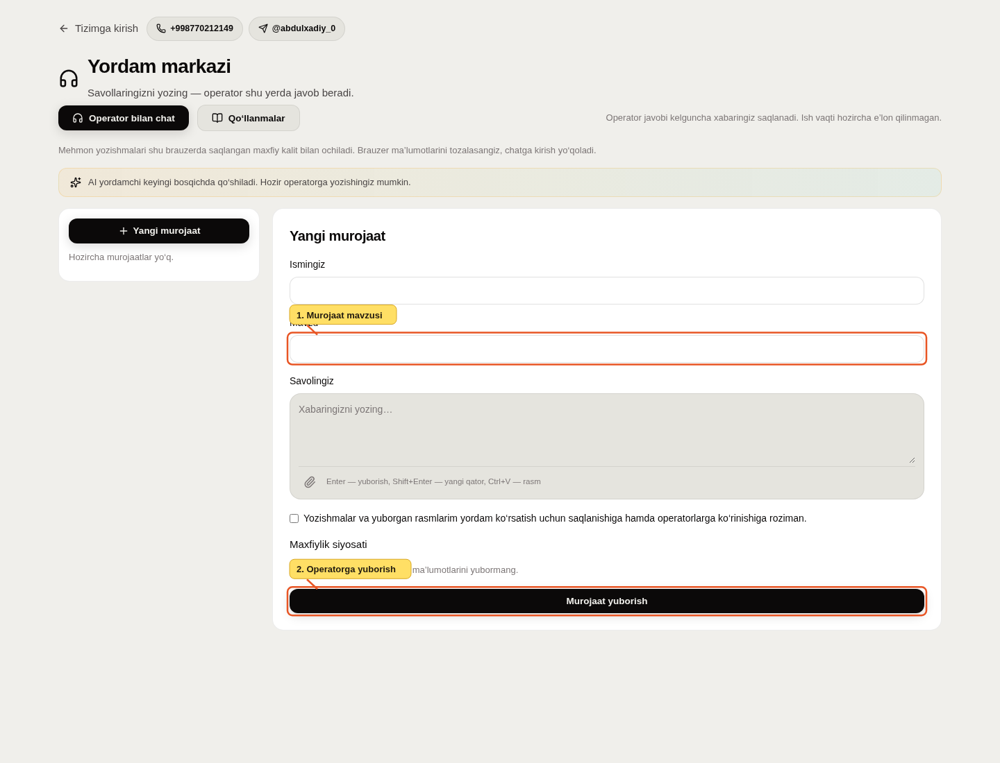

# ILBI: boshlash va yordam olish

Yangilangan: **2026-10-14**.

## Platformaga qo‘shilmoqchimisiz?

Do‘kon ochish yoki imkoniyatlar haqida so‘rash uchun akkaunt shart emas. Login sahifasidagi **Yordam markazi**ni oching. Telefon: **+998 77 021 21 49**; Telegram operator: **@abdulxadiy_0**.

## Operatorga murojaat

1. **Yangi murojaat**ni bosing. Ismingiz, mavzu va savolingizni yozing. Tildan o‘zbek, rus yoki inglizchani tanlang.
2. Yozishmalar saqlanishi va operatorlarga ko‘rinishi haqidagi tanlovni o‘qib belgilang, keyin **Murojaat yuborish**ni bosing.
3. Javob shu chatga keladi. Sahifani yopib ochsangiz, shu brauzerdagi maxfiy kalit orqali suhbatni davom ettirasiz. Brauzer ma’lumotlarini tozalash kalitni ham o‘chiradi. Boshqa qurilmada bu chat avtomatik ochilmaydi.
4. Zarur bo‘lsa **Rasm qo‘shish** orqali PNG, JPEG yoki WebP yuboring; limit 2 MB. Faqat muammoga tegishli joyni oling.

**Operator kutilmoqda** — murojaat navbatda; **Jarayonda** — operator qabul qilgan; **Yopilgan** — suhbat tugatilgan. Savol qolsa **Qayta ochish**ni bosing.

Operator ish vaqti va kafolatlangan javob muddati hali e’lon qilinmagan. Xabar saqlanadi; zaruratda telefon yoki Telegramdan foydalaning. AI yordamchi keyingi bosqichda muhokama qilinadi, hozir avtomatik AI javoblari yo‘q.

## Hisobingiz bo‘lsa

Login, telefon yoki email va parol bilan kiring; talab qilinganda Telegram OTP’ni kiriting. Login boti **@ilbi_bot**, inson operator **@abdulxadiy_0** — vazifalari alohida.

Tizimga kirgach **Qo‘llanma & Hujjatlar**da rolingizga mos amaliy yo‘riqnoma ochiladi. Do‘kon egasi katalog, ombor, xodim va sozlamalarni boshqaradi; xodim faqat berilgan ruxsatlar bilan ishlaydi.

Hozir chakana POS UZS bilan ishlaydi, production savdosi fiskal integratsiya tayyor bo‘lguncha yopilgan. Qo‘llanmadagi savdo rasmlari demo muhitiga tegishli.

## Xabar yuborishdan oldin

Parol, OTP, bank karta ma’lumotlari yoki mijozlarning ortiqcha ma’lumotlarini yubormang. Chatni ochish uchun saqlangan mehmon kalitini boshqalarga bermang. Shaxsiy ma’lumot bo‘yicha so‘rovni shu operator kontaktlari orqali yuborish mumkin.
