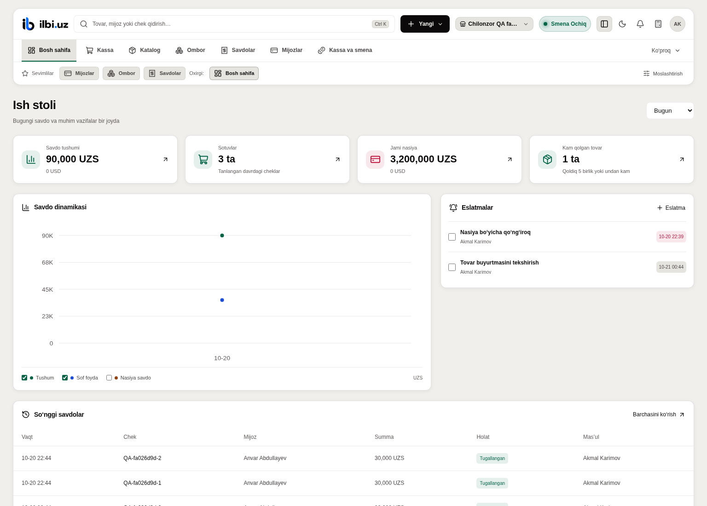
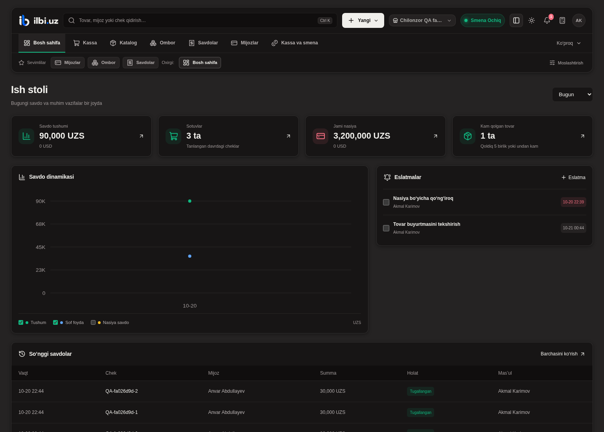

# ILBI v1.2.0

Chiqarish sanasi: 2026-10-20. Platformaning backend va frontend versiyasi `1.2.0`.
Avvalgi GitHub tagi `v0.16.0`; `v1.2.0` joriy imkoniyatlar uchun tanlangan yangi chiqarish raqami.

## Yangi imkoniyatlar

- Mijoz va boshlang‘ich qarzlarni XLSX yoki CSV faylidan yuklash: namuna, oldindan tekshirish,
  qator xatolari, telefon dublikatlari va takroriy saqlashdan himoya. UZS/USD qoldiqlari
  kassaga pul tushumi sifatida yozilmaydi; import do‘kon va foydalanuvchi ruxsatlari bilan chegaralangan.
- Klassik ish stoliga qo‘shimcha Tezkor ish stoli: yuqori navbar, mavzu tugmasi yonidagi
  ixcham almashtirgich va yumshoq animatsiya. Tanlov hisob uchun saqlanadi;
  sahifa, savat va ochiq forma ikki ko‘rinishda umumiy qoladi. Telefon ko‘rinishi avvalgidek ishlaydi.
- `Ctrl+K` orqali tovar, mijoz va chek qidirish; tezkor amallar, tanlangan va oxirgi sahifalar,
  kalkulyator, to‘liq ekran hamda haqiqiy savdo ma’lumotlari bilan yangi dashboard.
- Do‘kon bo‘yicha eslatmalar: muddat, xodimga biriktirish, bajarish/qaytarish va o‘chirish.
  Xodimlar o‘zlariga tegishli eslatmalarni ko‘radi; yashirin yoki klassik ish stolida qo‘shimcha polling to‘xtaydi.

## Tuzatishlar

- Bir vaqtda ochilgan dialoglarning sarlavha identifikatorlari alohida.
- HTTPS domenini faollashtirishda backend va Celery domen sozlamalari ham qayta yuklanadi;
  tayyor bo‘lmagan DNS uchun aniq ko‘rsatma chiqariladi.
- Manba backupiga uchta `.env.production.example` namunasi kiradi. Haqiqiy maxfiy `.env` fayllari kiritilmaydi.
- Telegram botning `aiohttp` lock yozuvi xavfsizlik tuzatishi mavjud versiyaga yangilandi
  ([aiohttp xavfsizlik xabari](https://github.com/advisories/GHSA-2g87-pp6c-29x5)).

## Yangilash

Yangi migratsiyalar: `core.0015`, `core.0016`, `sales.0018`. Odatdagi yangilash jarayonida
backupdan keyin `python manage.py migrate` bajariladi. Production entrypoint migratsiyalarni o‘zi bajaradi.

GitHub repository variable `DEPLOY_ENABLED=false` ekanligi 2026-10-20 kuni tekshirildi.
Shuning uchun ushbu push serverni avtomatik deploy qilmaydi. Workflow faqat
`DEPLOY_ENABLED=true` bo‘lganda va `main` push CI muvaffaqiyatli tugaganda deploy qiladi.
Tag va Release serverni alohida yangilamaydi. Operator tartibi: [ops qo‘llanmasi](../../ops/README.md).

## Tekshiruv

891 backend testi, 58 frontend testi, 26 chiqarish avtomatizatsiyasi testi,
13 bot testi va 15 deployment testi; API sxemasi, lint va frontend build.
XLSX import va ish stoli avval haqiqiy brauzerda ham tekshirilgan:
do‘kon/ruxsat chegaralari, savat va forma saqlanishi, qidirish, eslatmalar, kunduzgi/tungi ko‘rinish va ekran o‘lchamlari.

