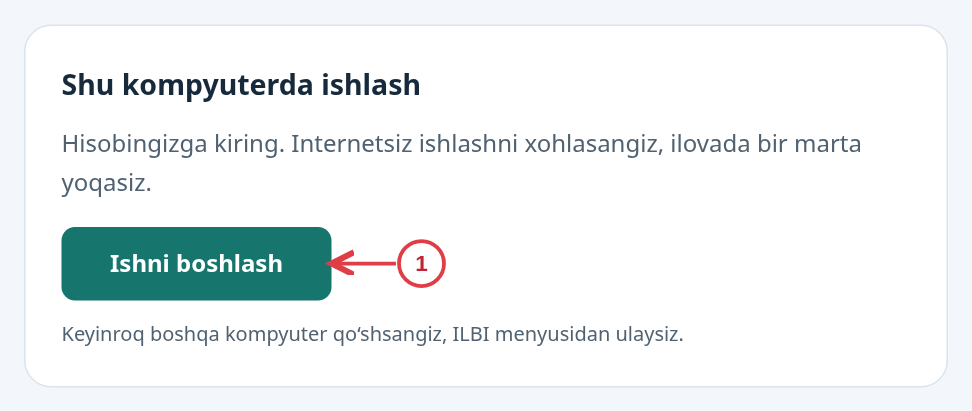
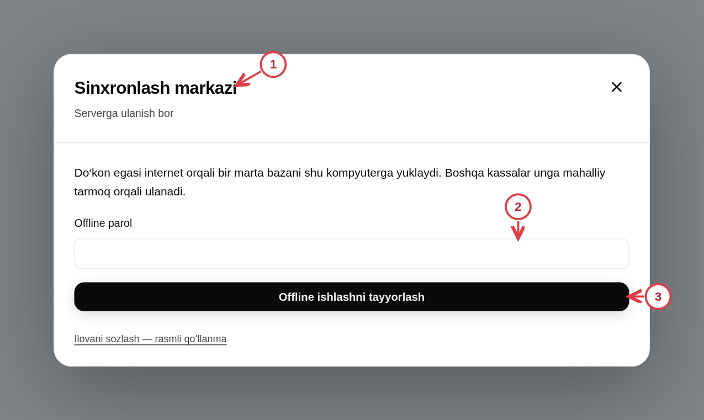
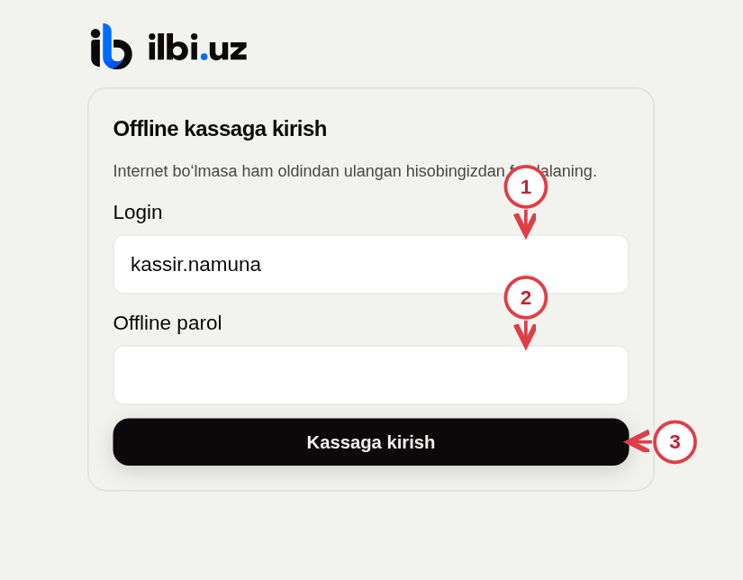
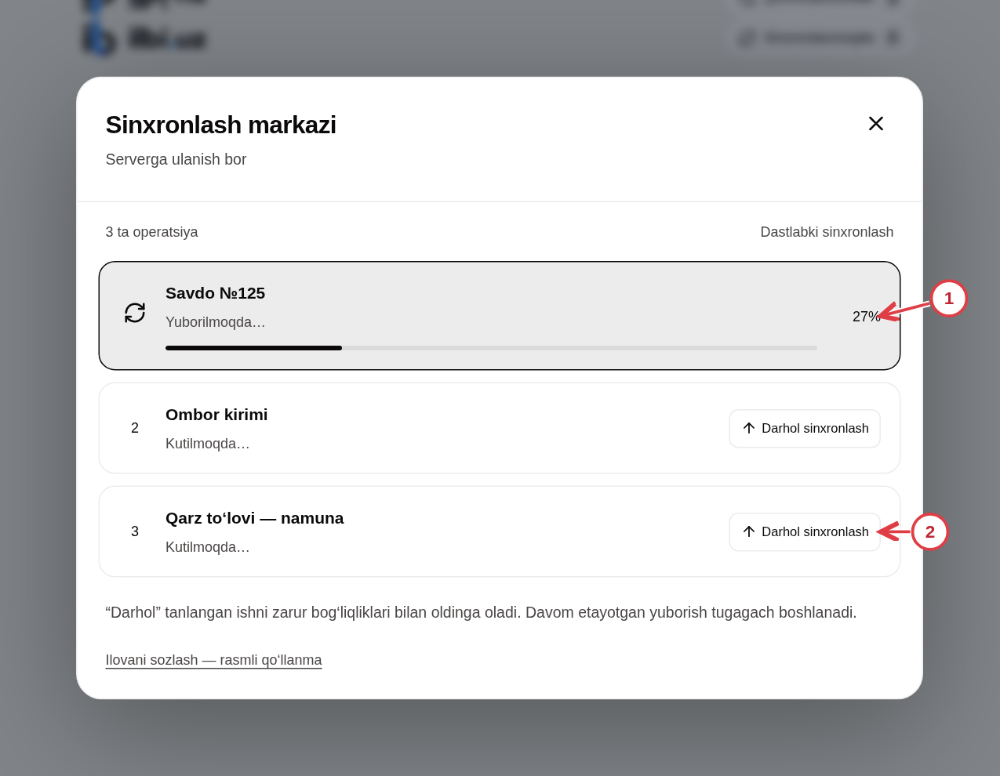
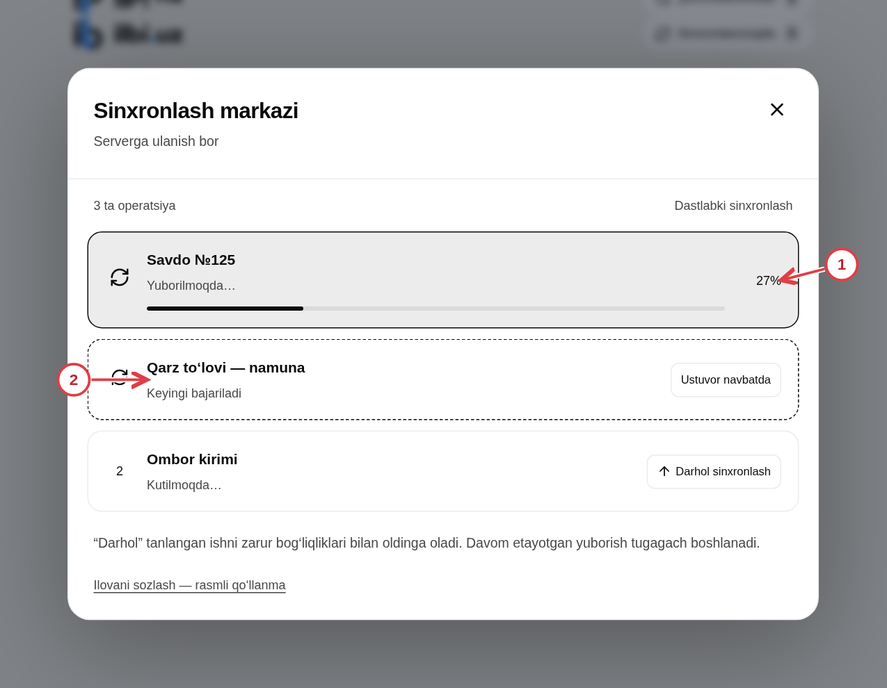
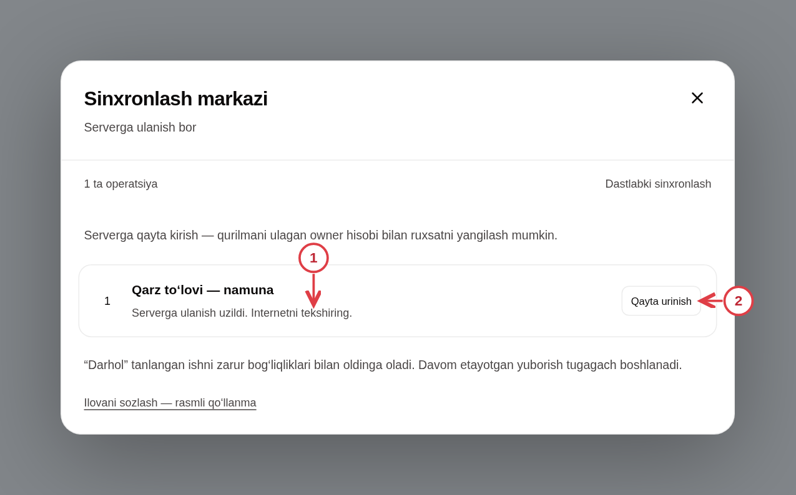
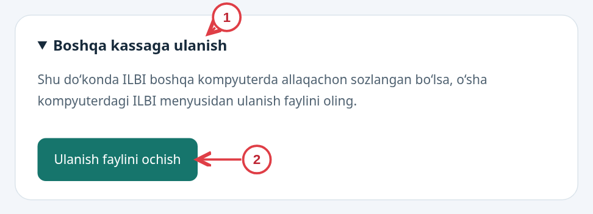

## 1. Ilovani birinchi marta sozlash

ILBI ilovasida kundalik savdo va ombor ekranlari webdagidek ishlaydi. Bu qo‘llanma faqat kompyuterga o‘rnatish, internetsiz ishlash va kassalarni ulashni tushuntiradi.

[Yuklab olish sahifasidan](/download) Windows uchun ILBI’ni oling. Yuklangan `.exe` faylni oching va o‘rnatishni tugating. Ish stolida paydo bo‘lgan **ILBI** belgisini ikki marta bosing.

Linux’da [qisqa 4 qadamli o‘rnatish yo‘riqnomasidan](/download#linux-install) foydalaning. [Batafsil Linux qo‘llanmasi](#7-linux-uchun-batafsil-qollanma) shu qo‘llanmaning oxirida. Quyidagi asosiy sozlash qadamlari Windows va Linux uchun bir xil.

Bitta kompyuterda ishlasangiz, boshqa kassaga ulanish yoki fayl ko‘chirish kerak emas. **Offline rejim ixtiyoriy:** odatiy hisobingiz bilan kirib, internet orqali darhol ishlashingiz mumkin. Offline tayyorlash oddiy amallarni bajarish uchun talab qilinmaydi. Internetsiz ham ishlamoqchi bo‘lsangiz, quyidagi 2-bo‘limni bajaring. Keyinchalik kassalar soni oshsa, boshqa kompyuterlarni shu tayyor kassaga ulashingiz mumkin; qayta sozlash talab qilinmaydi. Boshqa, mustaqil do‘konlar o‘z ilovasini alohida sozlaydi.

**Ishni boshlash** tugmasini bosing va kirish oynasi ochilishini kuting. Birinchi tayyorlash odatdagidan uzoqroq davom etishi mumkin.

Server manzili avtomatik tanlanadi va ilova ichida o‘zgartirilmaydi. Login va sinxronlash faqat rasmiy `https://ilbi.uz` serveri orqali ishlaydi. Rasmiy manzil `https://ilbi.uz`. Eski versiya ishlatilayotgan bo‘lsa, yangi rasmiy paketni shu saytdan o‘rnating; manzilni qo‘lda kiritish kerak emas. “Server manzili rasmiy ILBI manziliga mos emas” xabari chiqsa, rasmiy sahifadan ilovani yangilang yoki yordamga murojaat qiling. Mahalliy baza va `device.vault` faylini o‘chirmang.

## 2. Do‘konni offline ishlashga tayyorlash

Offline rejim sozlanmaganida yuqorida **Internetsiz ishlamaydi** ogohlantirishi ko‘rinadi. Bu holatda internet uzilsa, ilovada ishlay olmaysiz. Ogohlantirish online ishlashni cheklamaydi; internetsiz ishlash kerak bo‘lsa, quyidagi tayyorlashni internet borida tugating.

Birinchi sozlashda internet kerak. **Do‘kon egasi** o‘zining odatiy hisobi bilan internet orqali kirsin. Ishlaydigan do‘konni tanlang; bitta do‘kon bo‘lsa, u avtomatik tanlanadi.

1. Ekranning yuqorisidagi **Online rejim** yozuvini bosing. Rasmda 1 bilan ko‘rsatilgan **Sinxronlash markazi** ochiladi. Bir nechta do‘koningiz bo‘lsa, shu oynada offline ishlaydigan do‘konni tanlang. Platforma administratori hisobida bo‘lsangiz, avval do‘kon egasi hisobiga kiring.
2. Alohida offline parol kerak emas. Hisobingizning odatiy paroli ishlatiladi; ichki baza va qurilma kalitlarini dastur tasodifiy yaratib himoyalaydi. Qayta tasdiqlash so‘ralsa, hozirgi hisob parolingizni kiriting.
3. **Internetsiz ishlashni yoqish** tugmasini bosing. Ruxsat tekshirilishi, ma’lumotlar va rasmlar yuklanishi, saqlanishini shu oynada kuzating. Tayyor bo‘lgach, dastur do‘konni ochadi.

Har bir kassir ham o‘z odatiy login, parol va tasdiqlash kodi bilan internet orqali bir marta kirsin. Hisob tayyor do‘konga avtomatik ulanadi. Zarur bo‘lsa, **Hisobni kassaga ulash**ni bosing. Boshqa kassirning login/parolidan foydalanmang. Eski nusxadan yangilaganda ham bir marta internet orqali kiring; avvalgi baza va yuborilmagan ishlar qoladi.

> [!TIP]
> Tayyorlashni internet bor paytda tugating. Internet uzilgandan keyin yangi do‘konni yuklab olish yoki ilgari ulanmagan hisobni tayyorlash imkoni bo‘lmaydi.

## 3. Internet bo‘lmaganda kirish

Tayyorlangan hisobda internet borida ham, yo‘g‘ida ham bitta kirish oynasi ishlaydi. Internet uzilib yoki qaytganda qayta login qilish kerak emas. Telegram tasdiqlash kodi shu qurilma va hisob uchun **24 soatda bir marta** so‘raladi. Shu muddat ichida qayta kirishda odatiy login va parol yetarli. Parol bilan kirish yoki avtomatik sinxronlash 24 soatlik muddatni uzaytirmaydi.

1. ILBI’ni oching. Odatdagi kirish oynasi chiqadi.
2. O‘z **login**ingizni va odatiy hisob **parol**ingizni kiriting.
3. **Davom etish** tugmasini bosing. Tayyorlangan hisobning 24 soatlik 2FA tasdig‘i hali amal qilsa, internet bo‘lmaganda ham ochiladi.

**Meni eslab qol** login va parolni tizimning himoyalangan omborida saqlaydi. Ilovani odatdagidek qayta ochganingizda login va parol joyiga qaytadi. Harakatsizlik sababli avtomatik chiqilganda yoki **Kassani qulflash** bosilganda esa login eslanadi, parolni o‘zingiz qayta kiritasiz; saqlangan parol o‘chmaydi. Belgini olib tashlasangiz, eslab qolingan ma’lumot o‘chiriladi.

**Kassalar va xavfsizlik → Kassani qulflash** orqali joyingizdan ketishda kassani qulflang. Ishlatilmasa, odatda **10 daqiqada** avtomatik qulflanadi; egasi 1–60 daqiqa tanlaydi. Klaviatura, sichqoncha, aylantirish yoki sensor orqali ishlash vaqt hisobini yangilaydi. Serverni tekshirish va token yangilanishi faollik hisoblanmaydi. Qoralamalar qoladi. Ko‘p noto‘g‘ri urinishdan keyin faqat o‘sha hisobga vaqtincha cheklov qo‘yiladi.

Klassik va Tezkor ish stoli shu ilovaning ichida ham bor. Tashqi ko‘rinishni almashtirish qayta sozlashni talab qilmaydi. Odatdagi savdo ekranlarini o‘rganish uchun web qo‘llanmasidan foydalanishingiz mumkin.

Internet yo‘q paytda bajarilgan ishlar avval shu do‘kon kompyuterida saqlanadi. Webdagi boshqa qurilmalar ularni **serverga yuborilgandan keyin** ko‘radi. Faqat yuklangan ma’lumotlar va rasmlar ochiladi; Telegram, to‘lov xizmatlari va do‘konlararo tasdiqlar uchun internet kerak.

**24 soatlik 2FA tasdig‘i tugagach internet va yangi Telegram kodi kerak.** Shu vaqtda internetsiz qayta kirib bo‘lmaydi. Mahalliy baza, yuborilmagan ishlar va qoralamalar o‘chmaydi.

Qurilmaning sinxronlash ruxsati oxirgi muvaffaqiyatli yangilanishdan keyin **7 kun** amal qiladi. Bu 24 soatlik kirish tasdig‘idan alohida: qurilma ruxsatining yangilanishi 2FA muddatini uzaytirmaydi. Qolgan vaqt **Sinxronlash markazi → Kassalar va xavfsizlik**da ko‘rinadi; 24 soatdan kam qolsa ogohlantiradi. Internet borida, navbat bo‘shamaganida ham, ruxsat avtomatik yangilanadi. Muddati tugasa, egasi internet orqali qayta kiradi. Server bekor qilgan ruxsat tekshirilgach to‘xtatiladi. Yuborilmagan ishlar o‘chirilmaydi. Kompyuter vaqtini orqaga o‘zgartirish aniqlansa, internet orqali qayta tasdiqlash talab qilinadi.

## 4. Ishlar serverga qanday yuboriladi?

Internet qaytganda dastur ishlarni avtomatik yuboradi. Har safar alohida tugma bosish shart emas. Tafsilotni ko‘rish uchun yuqoridagi **Offline**, **Sinxronlanmoqda** yoki **Sinxronlangan** yozuvini bosing.

1. **Yuborilmoqda…** qatoridagi foiz hozirgi yuborish holatini ko‘rsatadi. **Server tasdig‘i kutilmoqda…** chiqsa, javob kelishini kuting; hali yakunlandi degani emas.
2. **Kutilmoqda…** qatorlari navbat bilan yuboriladi. Aynan bir ish tezroq kerak bo‘lsa, uning **Darhol sinxronlash** tugmasini bosing.

Davom etayotgan ish to‘xtatilmaydi. Tanlangan qator silliq siljib, uning tagiga joylashadi va **Keyingi bajariladi** deb ko‘rinadi. Aylanuvchi strelkalar bilan ajratiladi. Unga zarur bog‘liq ishlar bo‘lsa, dastur avval ularni yuboradi.

**Barcha operatsiyalar yuborilgan** yozuvi va bo‘sh navbat — mahalliy ishlar serverga yetganini bildiradi. Kun oxirida shu holatni tekshirib oling. Ilova yangilanganda yuborilmagan navbat ham saqlanadi.

**Tekshirish kerak** chiqsa, shu yozuvni ochib xato sababini o‘qing. Internet yoki kirish ruxsati muammosini hal qilgach, ruxsat berilgan qatorda **Qayta urinish**ni bosing. **Serverga qayta kirish** havolasi chiqsa, qurilmani ulagan do‘kon egasi hisobidan kiring. Bog‘liq operatsiya bloklangan bo‘lsa, avval uning sababini hal qiling; ma’lumotni qaytadan kiritish yoki bazani o‘chirish shart emas.

## 5. Shu do‘konga ikkinchi yoki uchinchi kassani ulash

Barcha kassalar bitta mahalliy tarmoqqa — bir routerdagi Wi-Fi yoki kabelga ulangan bo‘lsin. Internet bo‘lmasa ham shu tarmoq ishlashi kerak.

1. Birinchi ulashda **ikkala kompyuterda internet bo‘lsin**. Asosiy kompyuterda egasi **ILBI → Kassalar va xavfsizlik → Boshqa kompyuterni ulash**ni ochsin.
2. **Ulanish kodini yaratish**ni bosing. Tasodifiy 8 raqamli kod **3 daqiqa** amal qiladi va bir marta ishlatiladi. Vaqt tugasa yoki noto‘g‘ri kompyuter so‘rov yuborsa, bekor qilib yangi kod yarating.
3. Qo‘shimcha kompyuterga ILBI’ni o‘rnating. Birinchi oynadagi **Boshqa kassaga ulanish**ni ochib kodni kiriting. Birinchi, yolg‘iz kassangizda bu bo‘lim kerak emas.

4. Ikkala ekranda ko‘ringan tasdiqlash belgisini solishtiring. Bir xil bo‘lsa, egasi **Ikkala ekrandagi belgi bir xil**ni belgilab, **Yangi kassani tasdiqlash**ni bossin. Tarmoq tanlash so‘ralsa, yangi kassa ulangan tarmoqni tanlang. Qolganini dastur bajaradi; fayl tashish kerak emas.
5. Kassir o‘z odatiy hisobi bilan kirsin. Hisob ilgari tayyorlanmagan bo‘lsa, birinchi kirishni internet borida bajarsin. Keyin internet bo‘lmasa ham bir router orqali ishlayveradi.

> [!IMPORTANT]
> Qo‘shimcha kassalar ishlashi uchun asosiy kompyuter ham, undagi ILBI ham ochiq turishi kerak. Oynani kichraytirish mumkin. Asosiy kompyuter uxlab qolsa, o‘chsa yoki ILBI yopilsa, qo‘shimcha kassalar umumiy bazaga ulana olmaydi.

Ulanmasa, bir xil mahalliy tarmoq va Windows’dagi ILBI uchun xususiy tarmoq ruxsatini tekshiring. Asosiy kompyuter manzili o‘zgarsa, qo‘shimcha kassada **ILBI → Asosiy kassaga qayta ulanish**ni tanlab yangi kod bilan ulang. Routerda asosiy kompyuterga doimiy mahalliy manzil ajratish buni kamaytiradi. Har bir kassa alohida kalit oladi. Egasi ro‘yxatdagi **Kassani uzish** orqali faqat o‘sha kompyuter ulanishini bekor qiladi. Bitta kompyuterli do‘konda qo‘shimcha kassa xizmati yoqilmaydi.

## 6. Ilovani yangilash va yordam

Internet borida yangi yangilanish haqida ilova ichida xabar chiqadi. ILBI oynasi oldinda bo‘lmasa, tizim bildirishnomasi ham ko‘rsatiladi. Istalgan payt **ILBI → Yangilanishni tekshirish** menyusi orqali tekshirishingiz mumkin. Bu imkoniyat Klassik va Tezkor ish stolida ham ishlaydi.

1. Hali saqlanmagan shakllarni saqlang. Asosiy kompyuterni yangilayotgan bo‘lsangiz, boshqa kassalarda ham ishni vaqtincha to‘xtating.
2. Xabardagi **Yuklab olish va yangilash** tugmasini bosing. Tizim bildirishnomasining ustiga bossangiz ham yuklash boshlanadi. Alohida oyna ochilib, yuklash foizini ko‘rsatadi. Paket yuklanib, tekshirilguncha ishlashda davom etishingiz mumkin.
3. Yuklash tugagach, ilova davom etayotgan amallar tugashini kutadi va o‘rnatuvchini o‘zi ochadi. ILBI yopiladi, dastur fayllari yangilanadi va ILBI avtomatik qayta ochiladi. Yuborilmagan ishlar o‘z navbatida qoladi.

Internet uzilsa yoki yuklash tugamasa, oynadagi xabarni o‘qing va **Qayta urinish**ni bosing. Tekshirilmagan paket o‘rnatilmaydi. Hozir yangilash qulay bo‘lmasa, xabarni keyinga qoldirishingiz mumkin.

**Eski ilovadan birinchi o‘tish:** yangilanish xabari hali yo‘q bo‘lgan nusxani bir marta [yuklab olish sahifasidagi](/download) yangi paket bilan yangilang. Windows’da yangi `.exe` faylni oching; Linux’da eski ILBI’ni yopib, yangi arxivdagi `bash install.sh` buyrug‘ini bajaring. Keyingi yangilanishlar yuqoridagi xabar orqali olinadi.

O‘rnatuvchi mahalliy baza, sozlamalar va yuborilmagan ishlarni saqlab qoladi. Ular Windows’da `%APPDATA%\ILBI`, Linux’da odatda `~/.config/ILBI` papkasida turadi (`XDG_CONFIG_HOME` belgilangan bo‘lsa, o‘sha joydagi `ILBI` papkasida). Papka yoki `device.vault`ni o‘chirmang. Kalitlar tizim hisobingiz va parollar omboriga bog‘liq; boshqa hisob yoki kompyuterga o‘tishni yordam bilan rejalashtiring.

**Shifrlangan zaxira:** asosiy kompyuterda **Kassalar va xavfsizlik → Shifrlangan zaxiralar**ni oching. Dastur ochiq bo‘lib, bir daqiqa ishlatilmaganda kuniga bir marta zaxiralanadi; oxirgi **7 nusxa** qoladi. **Hozir zaxiralash** bilan qo‘lda ham yaratasiz. Shu payt kassa bazasi izchil nusxa olish uchun qisqa to‘xtaydi; kassalarda ishni kutib turing. Baza, yuborilmagan ishlar, rasmlar va shu kompyuterdagi qoralamalar kiritiladi. Qo‘shimcha kassalarning qoralamalari o‘z kompyuterida qoladi.

**Tiklash:** ro‘yxatdan zaxirani tanlang, egasi odatiy parolini kiritsin va alohida oynada tasdiqlasin. Avval zaxiraning yaxlitligi tekshiriladi, keyin hozirgi holat alohida yangi zaxiraga olinadi. Tanlangan nusxa tiklangach qayta kirasiz. Keyingi sanada bajarilgan ishlar tiklashdan oldingi yangi zaxirada qoladi. Boshqa kassalardagi ishni oldindan to‘xtating.

Zaxiralar shu o‘rnatish kaliti bilan shifrlangan; disk ishdan chiqishi yoki tizim kalitlari yo‘qolishidan himoya bermaydi. Ishlayotgan PostgreSQL fayllari to‘liq disk shifrlanishi bilan himoyalanmaydi: Windows’da BitLocker, Linux’da LUKS kabi disk himoyasini tizim o‘rnatishda alohida sozlash mumkin. Baza parolini fayllarning shifrlanishi deb hisoblamang.

Qo‘llanma **ILBI → Ilovani sozlash (rasmli qo‘llanma)** menyusidan ham ochiladi. Uning matni va rasmlari ilova ichida saqlanadi, shuning uchun internet kerak emas. Rasm ustiga bossangiz kattalashadi; `Esc` bilan yoping.

Yuklab olish sahifasi do‘konni ulashdan oldin ham ochiladi. **Yuklamalar ro‘yxati ochilmadi** chiqsa, **Qayta tekshirish**ni bosing. Internet ishlayotgan bo‘lsa ham rasmiy server bilan ulanish vaqtincha uzilishi mumkin. Ilovadagi **Saytda ochish** tugmasi yuklab olish sahifasini odatiy brauzeringizda ochadi.

Muammo qolsa, [Yordam markaziga](/support) murojaat qiling. Qaysi kompyuter asosiyligi, ekrandagi xato va sinxronlash navbatida yuborilmagan ish bor-yo‘qligini yozing.

> [!NOTE]
> Joriy yuklama sinov nusxasidir. Haqiqiy POS savdosi mavjud fiskal ulanish chekloviga bo‘ysunadi; ilovani o‘rnatish bu cheklovni olib tashlamaydi. Rasmlardagi do‘kon va operatsiyalar tushuntirish uchun yaratilgan namunalardir.

## 7. Linux uchun batafsil qo‘llanma

[Yuklab olish sahifasidan](/download) **Linux uchun yuklab olish** tugmasidan `.tar.gz` arxivni oling. Arxivni oching, ichidagi **ILBI** papkasida terminal ochib `bash install.sh` buyrug‘ini bajaring. `sudo` ishlatmang. Keyin ilovalar menyusidan **ILBI**ni oching. VirtualBox, Wine, Docker, alohida Python yoki PostgreSQL kerak emas. Linux x86_64, grafik ish stoli va ochilgan GNOME Keyring yoki KWallet parollar ombori kerak; Arch Linux va Ubuntu 22.04+ uchun paket tayyorlanadi.

**Arch Linux uchun qadamlar:**

1. **Linux uchun yuklab olish** tugmasini bosing. Fayl menejerida yuklangan `ILBI-…-linux-x64.tar.gz` arxivini ochib, bir papkaga chiqaring. Fayl nomida yuklangan versiya raqami yoziladi.
2. Hosil bo‘lgan **ILBI** papkasiga kiring. Bo‘sh joyni o‘ng bosib **Terminalda ochish**ni tanlang.
3. `bash install.sh` yozib, `Enter` bosing. O‘rnatish administrator parolisiz bajariladi. Ilovalar menyusida **ILBI** paydo bo‘ladi. Menyuda darhol ko‘rinmasa, `~/.local/bin/ilbi` buyrug‘i bilan oching.
4. **Ishni boshlash**ni bosing va yuqoridagi 2-bo‘lim bo‘yicha do‘konni ulang.

Agar ilova kutubxona yetishmayotganini aytib ochilmasa, Arch’ni yangilab, grafik kutubxonalarni o‘rnating: `sudo pacman -Syu --needed gtk3 nss alsa-lib libxss libxtst libsecret gnome-keyring`. GNOME/KDE’da parollar ombori odatda kirishda ochiladi; Hyprland kabi ish stollarida uning ishga tushishini va qulfdan ochilishini alohida sozlash kerak bo‘lishi mumkin. ILBI’ni `sudo` yoki `--no-sandbox` bilan ochmang.

**Parollar va kalitlar** menyuda ko‘rinmasa, omborni boshqarish oynasini `sudo pacman -Syu --needed seahorse` orqali o‘rnating. Oynada **Login / Kirish** ustiga o‘ng bosib **Unlock / Qulfni ochish**ni tanlang.

Linux’da birinchi ochishda parollar ombori ruxsat so‘rasa, shu foydalanuvchi uchun ruxsat bering. Bu ombor qurilma kalitlarini himoya qiladi. ILBI Hyprland va Sway’da ham mavjud GNOME Keyring’ni o‘zi tanlaydi; qo‘shimcha ishga tushirish buyrug‘i kerak emas. KDE’da KWallet ishlatiladi. Windows va Linux’da qolgan sozlash qadamlari bir xil; quyidagi rasmlar ikkala nusxaga ham tegishli.

**“Parollar omboriga ulanib bo‘lmadi” chiqsa:**

1. Ilovalar menyusidan **Parollar va kalitlar (Passwords and Keys)** yoki **KWallet Manager**ni oching.
2. **Login / Kirish** omborini oching. Qulf so‘ralsa, tizim parollar ombori parolini kiriting.
3. ILBI oynalarini yoping va ilovalar menyusidan qayta oching. **Ishni boshlash**ni yana bosing.
4. Ombor dasturi umuman yo‘q bo‘lsa, quyidagi Arch buyrug‘i bilan GNOME Keyring’ni o‘rnating yoki yordam xizmatiga murojaat qiling. Ma’lumotlar papkasi va `device.vault` faylini o‘chirmang.

Hozir `yay -S ilbi` va `sudo pacman -S ilbi` orqali tarqatilmaydi: AUR yoki alohida paket repozitoriysida hali e’lon qilinmagan. Rasmiy yuklab olish sahifasidagi arxivdan foydalaning. Shu arxiv boshqa mos x86_64 Linux tizimlarida ham ishlaydi; Ubuntu 22.04+ va Arch uchun tekshiruv bor. ARM kompyuterlar va Alpine kabi musl tizimlari ushbu paketga kirmaydi.
